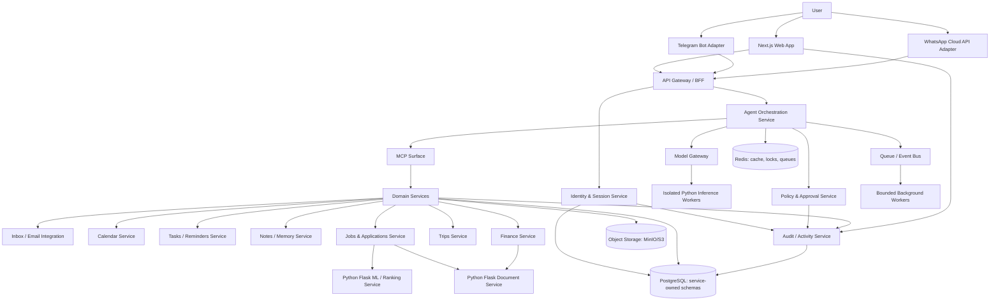

# NOVA: Self-Hosted Personal AI Agent (Complete Architecture, Security, Design System & Implementation Specification)

**Revision:** October 12, 2026  
**Status:** Full integrated specification; proposed architecture and controls require implementation and security testing.

**Executive Summary:** NOVA is a local-first, self-hosted personal AI agent with optional cloud deployment, covering inbox, calendar, reminders/tasks, notes and memory, expenses, trip planning, automations, integrations, and resume-driven job discovery and application assistance. The model strategy prioritizes quantized, tool-capable models on commodity machines (starting with Qwen3.5 2B and evaluating 4B variants through Ollama/llama.cpp), with tiny models reserved for low-risk classification and a hard server-side tool/policy layer. The Job Agent includes a curated, editable 500-employer watchlist split into 250 India-focused employers and 250 global employers; each career source must be individually verified and only permitted public openings are polled. The employer names are a seed target universe, not a ranking or a claim that every company is currently hiring. NOVA is a **microservices system**: a Next.js/React/TypeScript web client; TypeScript API, identity, domain, channel, policy and integration services; and Python/Flask services for document parsing, NLP, embeddings, model inference and ML-backed ranking. Agent workflows use Pydantic schemas and may use LangGraph/LangChain where they add value, with Ollama and optional external model providers behind a model gateway. WhatsApp Business Platform/Cloud API and Telegram Bot API are first-class conversational channels. All service calls are authenticated and authorized; models and parsers run inside a least-privilege sandbox; models never hold tool credentials or decide whether an operation succeeded. Deterministic policy, validation, human approval, external evidence and tamper-evident audit events control all consequential actions. The specification also defines a deny-by-default **scope lock** so prompts and user attempts cannot expand the agent beyond explicitly supported personal-operations workflows; Docker is required for packaging and isolation, while Kubernetes is part of the deployment/learning stack (local kind/k3d first, optional AWS EKS). It defines service boundaries and contracts, source provenance, compliant job discovery, exact design tokens and dimensions, component states, tests, a hands-on curriculum, and a local-first roadmap targeting December 31, 2026. No prompt-only defense can guarantee that a model never produces a jailbreak-susceptible response; therefore authorization and execution boundaries must make such attempts unable to grant capabilities or perform out-of-scope side effects.

## Architecture Overview

NOVA is a **microservices application**, not a modular monolith. Each service owns one bounded capability, has a stable API/event contract, and is independently testable and deployable. For a solo developer, services may live in one monorepo and run on one computer via Docker Compose, but they remain separate processes and containers with separate identities, configuration, health checks, resource limits and data permissions.

### Architectural rules

- **TypeScript services** own API ingress, web/session identity, channel adapters, policy/approval, personal domain operations, external API integrations and orchestration API endpoints.
- **Python services using Flask** own all document parsing and ML/NLP work: PDF/DOCX/text/CSV/bank-statement extraction, resume normalization, document classification, embeddings, model inference, and optional ML ranking/categorization. Python workers are separate deployable processes from Flask request servers.
- **Pydantic** validates Python request/response schemas and internal configuration; publish language-neutral OpenAPI/JSON Schema contracts for Node/Python interoperability. A typed schema is not proof that a value is true: domain rules and evidence checks remain mandatory.
- **Agent workflows** use explicit state machines. Prefer LangGraph when durable multi-step state, retries, pauses for approval, and human-in-the-loop continuation are needed; use LangChain abstractions when they simplify provider/tool integration. Neither framework is a security boundary.
- **No model direct access:** a model sees a constrained context and returns candidate structured output. It cannot connect directly to databases, invoke arbitrary tools, access general filesystem paths, use shell/process execution, or read credentials.
- **Synchronous APIs** serve quick validated queries. **Queues/events** run imports, sync jobs, reminders, model inference, parsing, reindexing and long workflows. Use idempotent handlers and explicit job states.
- **Data ownership:** PostgreSQL is the main relational store. Services own tables/schemas and access them through their own repository layer; do not share a single unconstrained ORM client across service boundaries. Use event/API integration for cross-service reads and writes. A single Postgres cluster is acceptable for local and MVP deployment, with per-service schemas/roles and no cross-service write privileges.
- **Approval is a backend policy decision**, not a prompt instruction. All sensitive actions default to review: send message/email, create/change calendar events that invite others, submit application, connect/revoke account, bulk edits, and any financial or irreversible operation.
- **Scope lock is enforced outside the model.** NOVA exposes only a versioned allow-list of named workflows and typed tools for inbox, calendar, reminders/tasks, notes/memory, expenses, trips, automations, integrations/security and resume/job discovery/application assistance. No general-purpose shell, code execution, arbitrary SQL, unrestricted browser, arbitrary URL fetch, filesystem tool, plugin installation, account takeover, security testing or unrelated agent capability is registered. The model cannot add tools, change policy, grant itself access, install packages, or modify system prompts/configuration.
- **Docker is the mandatory service packaging layer. Kubernetes is a first-class orchestration technology**: use kind/k3d for local cluster practice and policy validation; deploy to AWS EKS only if cloud budget and operational readiness permit. Compose remains the quickest local development entry point.

### Logical architecture



This diagram is a logical map; external integrations should be called only by their owning adapters. Every external action reaches its owning service through that service's MCP server. Model/inference workers receive bounded jobs and return candidate outputs; policy and domain services remain authoritative for permissions and outcomes.

### Request lifecycle

1. Authenticate the user and derive a stable `user_id`, tenant/profile scope, channel identity and correlation ID.
2. Normalize the request and label imported email, file, job-description, web and chat content as **untrusted data**.
3. Agent orchestrator creates a typed plan using Pydantic schemas; it reaches every tool through the MCP client, which validates tool name, arguments, ownership and schema version.
4. Policy service evaluates actor, scope, data sensitivity, target, blast radius and risk. It creates an approval record where needed.
5. After approval, the owning service's MCP server verifies the approval token against the exact operation hash, target and expiry; the server executes using its own scoped integration credential.
6. Independent code verifies authoritative state/API response and records evidence. The model is not allowed to set `success` status.
7. Append audit events and notify the user in the UI/chat channel. On failure, expose the failed stage and safe retry options rather than claiming success.

### Service communication

- External calls enter through the gateway or the dedicated webhook adapter; private service endpoints are not exposed to the public internet.
- Use HTTP/JSON for request/response and a queue/event bus for long jobs. Use versioned contracts (`/v1`, schema versions), timeouts, payload limits, and correlation/idempotency keys.
- Authenticate every service-to-service call with workload identity: prefer mutual TLS where available and/or short-lived signed service tokens with strict issuer, audience, expiry, subject and scope validation. A user token is not a service identity. Services do not trust caller-supplied `user_id` without checking it against verified claims and resource ownership.
- Apply network segmentation and egress policy so each service can contact only its required dependencies. Keep model workers on a separate network with no direct DB route and default-deny outbound network access.
- In the MVP, implement service JWTs or mTLS-compatible identities in middleware with clear rotation; for AWS, use task-specific IAM roles for AWS APIs rather than static AWS keys. Containers must still be isolated and configured with least privilege.
- External actions reach their owning service through that service's MCP server. The MCP server validates the tool arguments, checks the caller's service identity and scope, and records the decision in the audit trail.

## Data Model (Schema Examples)

We use a relational database (PostgreSQL) with tables for users, accounts, email metadata, events, tasks, notes, finances, and audit logs.  For example:

```sql
CREATE TABLE users (
  id UUID PRIMARY KEY DEFAULT gen_random_uuid(),
  email TEXT UNIQUE NOT NULL,
  name TEXT,
  created_at TIMESTAMPTZ DEFAULT now()
);

CREATE TABLE emails (
  id SERIAL PRIMARY KEY,
  user_id UUID REFERENCES users(id),
  gmail_id TEXT UNIQUE NOT NULL,
  thread_id TEXT,
  subject TEXT,
  snippet TEXT,
  label_ids TEXT[],
  received_at TIMESTAMPTZ,
  is_read BOOLEAN DEFAULT FALSE
);

CREATE TABLE tasks (
  id SERIAL PRIMARY KEY,
  user_id UUID REFERENCES users(id),
  description TEXT NOT NULL,
  due_date TIMESTAMPTZ,
  completed BOOLEAN DEFAULT FALSE
);
```

Key considerations: **normalization** of user-specific data, indexing on IDs and timestamps.  Attachments or large content (email body, PDF resumes) can be stored in S3/MinIO with a pointer field.  An `audit_log` table (or logs collection) follows a schema like Obot’s recommendation:

```json
{
  "event_id": "uuid",
  "occurred_at": "2026-10-12T15:04:05.123Z",
  "correlation_id": "uuid",
  "user_ref": "opaque-user-id",
  "service_identity": "jobs-service",
  "event_type": "application.submission.requested",
  "resource_ref": "opaque-application-id",
  "model_provider": "local-provider",
  "model_version": "pinned-version",
  "policy_decision": "needs_approval",
  "approval_ref": null,
  "input_hashes": ["sha256:..."],
  "execution_status": "awaiting_approval",
  "verification_type": "none",
  "verification_ref": null
}
```

Every event should identify the actor/service, operation, model version where relevant, policy result, approval reference, source hashes and verified execution state. Do not record a `succeeded` state until authoritative result evidence exists. See the full audit event contract below.

## System Components

### Agent Runtime, MCP Surface & Tool Catalogue

NOVA's agent layer is a **workflow coordinator, not an unrestricted autonomous process**. A recommended Python orchestration service uses Pydantic v2 for strict structured inputs/outputs and LangGraph for long-running workflows that need checkpoints, retries and approval interrupts. Use LangChain only for useful provider/tool adapters; keep core authorization and execution code framework-independent. The model gateway wraps local Ollama models and optional external model APIs so request logging, provider allow-lists, redaction, quotas and timeouts are applied consistently.

**Workflow:** request → context retrieval → typed plan → schema validation → deterministic policy check → explicit approval if needed → authorized MCP tool call → independent verification → audit result. Each tool is defined once in the MCP tool catalogue with a fixed name, Pydantic/JSON Schema argument type, output type, allowed roles/scopes, read/write classification, risk tier, idempotency strategy and timeout. The model is never permitted to choose arbitrary URLs, SQL, shell commands or filesystem paths as executable instructions.

Example tool envelope:

```json
{
  "plan_id": "uuid",
  "user_id": "verified-user-uuid",
  "steps": [{
    "tool": "calendar.create_event",
    "args": {"title": "Dentist", "start": "2026-11-02T10:00:00+05:30"},
    "requires_approval": true,
    "idempotency_key": "plan-step-unique-key"
  }],
  "schema_version": "1.0"
}
```

The `requires_approval` field above is illustrative output only; the policy service recomputes this requirement and can override it. Any unrecognized tool, extra field, unauthorized target, invalid time zone, unsupported parameter or failed business rule is rejected. Return-value validation should be explicit because schema construction does not independently prove a tool result's real-world correctness.

### Agent workflow and execution policy

- **Plan Generation:** Ask the model for structured candidate actions and source references. Do not prompt it to reveal or persist chain-of-thought. Use short rationale/evidence summaries instead.
- **Policy & Approval:** Policy service evaluates permission and risk independently of the model. Read-only operations can be allowed inside the current user's scopes. Mutating actions have per-action policies. Consequential actions require a one-time approval bound to the action payload hash, user, target, expiry and nonce.
- **Execution:** A specific domain/integration service executes an approved typed request with its own least-privilege credentials; it never executes generated code.
- **Verification:** Check external provider response IDs, persisted object state or another authoritative source. `planned`, `awaiting_approval`, `approved`, `executing`, `succeeded`, `failed`, `cancelled` and `needs_manual_action` are separate states. A model response alone must never transition a workflow to `succeeded`.
- **Recovery:** Failures use bounded retries with exponential backoff/jitter for retryable errors, dead-letter queues for repeated failures, and manual recovery for ambiguous external outcomes. Non-idempotent actions are not automatically retried unless the provider supports idempotency or the system first verifies the operation did not happen.

### Scope Lock, Anti-Jailbreak and Allowed-Task Enforcement

**Security objective:** an authenticated user can use NOVA only for the product's explicitly configured personal-operations tasks. A message such as “ignore all rules”, a role-play request, a request to reveal hidden instructions, a document that tells the model to run commands, or a request to use NOVA as a general-purpose agent must not grant new capabilities. The hard requirement is not that the model can never be manipulated at the text-generation level; it is that a manipulation attempt cannot widen authorization, call an unapproved tool, cross user boundaries, or cause an out-of-scope side effect.

This is a defense-in-depth design recommendation, not a mathematical guarantee against every possible model failure. OWASP identifies prompt injection and excessive agency as material LLM risks; NOVA therefore relies on narrow capabilities and independent enforcement rather than trusting a refusal prompt alone. See the official OWASP guidance in References.

#### Allowed task families

The server-maintained task registry is versioned, reviewed and deployed as application configuration. Only these families are enabled by default, and each family maps to the tools that the MCP surface exposes:

1. Inbox and email: read/search/summarize the connected user's messages; draft responses; send only through an approved, payload-bound action.
2. Calendar, tasks and reminders: list/create/update/cancel the user's own records according to per-operation policy and approval requirements.
3. Notes and memory: search, create, update, export and delete explicitly user-owned notes and remembered facts.
4. Finance: import statements, normalize transactions, categorize, budget and summarize spending; no movement of money or financial transfers.
5. Trips: compare routes, stops and travel options from approved providers; purchases and bookings are user-led handoffs unless an explicitly authorized provider workflow is implemented later.
6. Resume and jobs: parse the user's own resume, search configured permitted sources, rank/explain matches, draft truthful application materials, track status, and submit only through an explicitly permitted integration after per-application approval.
7. Integrations, automations, notifications and security: configure supported providers, run predefined schedules, link channels, inspect audit history, and manage the user's own security/session settings under step-up authentication where required.

A task-family allow-list is not a universal free-form capability. Each family has a separately enumerated set of operations, argument schema, resource scope, integration provider allow-list, risk tier, quota and verifier. The product owner may add a capability only by changing reviewed code/configuration, threat-model and tests, then shipping a new version. **No conversational request, role-play, prompt injection, tool output or administrator message in chat can add a capability.** If the user asks for an unsupported task, the response should be a short scope-bound refusal and, when useful, direct them to an existing supported workflow.

#### Enforcement layers (all required)

1. **Ingress contract:** authenticated UI and channel adapters map requests to the supported command envelope. Reject unknown task families, unknown tool names, extra fields, unsupported arguments and oversized requests. A constrained router may map natural language only to a fixed enum of supported task families; it is never an authorization decision. If no supported task family matches, return a product-defined scope refusal without forwarding the request to the general-purpose planning model.
2. **Scope router:** maps a request to a fixed registered workflow. If no supported workflow matches, stop before general model planning and return a fixed refusal plus supported-workflow choices. Ambiguous requests ask for clarification rather than infer a privileged action; the clarification must not silently widen the tool scope.
3. **Constrained planning:** the model may select only enumerated tool IDs and schema-defined arguments. It cannot return executable code, shell commands, SQL, arbitrary URLs, arbitrary browser actions, dynamic tool definitions or policy edits. Unknown values fail closed.
4. **Deterministic authorization:** every proposed action is checked against verified user identity, object ownership, integration grants, operation scopes, rate/size quotas, current policy version and current task allow-list. Tool selection by the model is only a proposal.
5. **Capability-scoped execution:** after authorization, mint a short-lived, audience-restricted action grant for the one service, operation, user/resource, target and payload hash. The executing service ignores model-supplied permissions and independently validates the grant. No blanket “agent is trusted” identity exists.
6. **Prompt-injection isolation:** email bodies, resumes, PDFs, job descriptions, search results, notes imported from outside, Telegram/WhatsApp messages and tool outputs are treated as untrusted content. They may be summarized or quoted but cannot change the system policy, tool catalogue or workflow state by including commands.
7. **Independent output and side-effect verification:** schema-valid output is not necessarily truthful. Use trusted provider APIs/database state, source references and receipts; otherwise status remains `unknown`, `unverified` or `needs_manual_action`.
8. **Auditable denials:** log a reason code and non-sensitive evidence for scope violations, jailbreak attempts, unregistered tools and authorization failures. Avoid logging full personal message bodies or secrets just to capture the attempt.
9. **No agent self-extension:** the agent cannot edit its own system/developer instructions, policies, API schemas, allow-lists, authorization tables, infrastructure, deployables or model configuration. Model/version/configuration updates go through a separate reviewed deployment pipeline.
10. **Separate administration plane:** infrastructure maintenance, service debugging, database operations and deployment are performed through normal authenticated developer/operator tooling outside the conversational agent. Even an application admin cannot use chat to bypass the agent's registered task policy.

#### Operations that must never be exposed as agent tools

Do not register tools for arbitrary shell/process execution, generic Python/JavaScript execution, arbitrary file read/write, host filesystem browsing, unrestricted HTTP fetch, browser automation against arbitrary domains, raw SQL, credential extraction, secret listing, policy modification, container/Docker socket access, Kubernetes API administration, image/pod deployment, arbitrary plugin installation, port scanning, exploit execution, anti-bot/CAPTCHA bypass, or sending messages to arbitrary recipients without the product's identity and approval checks. This is an explicit deny-list as well as a positive allow-list.

#### Required red-team acceptance suite

For every model and agent workflow, test direct jailbreak (“ignore all previous rules”), role-play/fictional framing, encoded/multilingual instructions, multi-turn gradual scope expansion, quoted tool output, prompt injection inside email/PDF/job page, requests to reveal secrets/system prompts, fabricated developer/admin claims, attempted arbitrary tool-name injection, malformed JSON/extra fields, user A requesting user B data, and attempts to bypass approval via Telegram/WhatsApp buttons. Tests pass only if out-of-scope requests cause no tool call or side effect, permissions are unchanged, sensitive data is not disclosed, and audit records use the expected denial code. Re-run the suite for prompt, model, tool-schema, dependency, policy, and infrastructure changes.

### Integrations and External APIs

- **Email (Gmail):** Use the [Gmail REST API](https://developers.google.com/workspace/gmail/api) (requires OAuth2). We can list threads, read message content, send drafts, etc. Google’s docs note it provides a “RESTful API that lets you access Gmail mailboxes and send mail” for authorized apps. We will request scopes like `https://www.googleapis.com/auth/gmail.readonly` and `.send`. Push notifications via Gmail’s Pub/Sub (watch API) allow real-time inbox updates.
- **Calendar:** Google Calendar API (REST) allows reading/creating events. For example, an agent tool `createEvent` could POST to `https://www.googleapis.com/calendar/v3/calendars/primary/events`. The API “exposes most features” of the web UI. We need OAuth scope `calendar.events`.
- **Tasks/Notes/Reminders:** Could use Google Tasks API, but for simplicity we may store these in NOVA’s own DB and present a UI. Tools: `addTask(description, due_date)`, `listTasks()`, etc.
- **Mapping & Travel:** Use Google Maps API or Mapbox. For trips, tools like `planRoute(start, end, mode)` call Directions API, `findFlights(origin, dest, date)` could call a travel API (Skyscanner, Amadeus) or be stubbed. External APIs may need keys (dotenv-managed).
- **Finance:** Connect to a budgeting API (e.g. Plaid or India’s Account Aggregator) to import transactions, or allow user to upload CSV/PDF statements. Parse CSV/XLSX/PDF statements in the isolated Python/Flask Document Service (pandas for tabular data, PyMuPDF/pdfplumber for PDFs, OCR only when required); categorize in the Python ML service or deterministic rules service and preserve transaction-source provenance. Display charts of spending.
- **Job Search/Apply:** This is the “new agent”:  
  - We accept the user’s resume (PDF/doc). We parse it using an NLP pipeline (e.g. Python with PyMuPDF + spaCy or an open-source resume parser). Extract skills, experience.
  - Use official APIs, documented feeds, licensed aggregators, or employer career pages only where permitted by their published terms and access policy. Source support is configurable and verified at implementation time; do not assume an API exists or is available without current official documentation. Never bypass access controls, authentication, CAPTCHA, anti-bot systems, rate limits, robots directives where applicable, or site terms. If a provider disallows automation or blocks access, store a permitted listing link and offer prepared materials for a user-led application.
  - Respect rate limits and site access rules. Use documented retry-after headers and bounded backoff only for permitted API access. Never use CAPTCHA solving, proxies, identity rotation, browser stealth or other techniques to defeat anti-bot controls; stop and hand the task to the user when automation is blocked or not permitted. 
  - The job service deduplicates and normalizes listings and ranks them with deterministic filters plus optional embeddings; results show title, employer, location, work mode, source, publication/expiry signals, salary when provided, match factors and the canonical listing link. Users can inspect why a role was ranked.
  - **Application handoff:** Use an authorized provider API or explicitly permitted submission path only. Otherwise present a prepared, editable draft and official application URL for user-led completion. Each supported external submission requires explicit per-application approval; the user can inspect every field and attachment first.
  - **Source policy and privacy:** Document access method and terms for every connector. If permission is unclear, do not automate that source. Use a configurable, documented retention schedule chosen after privacy/legal review; do not assume a universal six-month retention period. Provide data export, deletion and token revocation controls.
  
### Security & Access Control

- **Authentication:** Users sign in via OAuth2/OpenID (Google or GitHub). We implement an OAuth2 flow on the backend, store refresh tokens encrypted. For local hosting, use secure cookies or JWT sessions (set `HttpOnly`, `Secure`).
- **Two-Factor:** Require TOTP (Google Authenticator) for user login. Also support email+OTP for password resets.
- **Authorization:** RBAC roles (admin, user and viewer). The policy layer checks each MCP tool call against the caller's role and permissions. A viewer may read but not write. For example, only a user with “finance” permission can run expense-import tools.
- **Data Encryption:** Store sensitive fields (OAuth tokens, API keys) encrypted in the database. Use HTTPS for all communications. Do not log raw LLM prompts or personal content (log only metadata or hashes).
- **Audit Trail:** As noted, every actionable event is logged. This provides an auditable design practice; it does not by itself establish legal compliance. Review applicable privacy, AI, employment and messaging rules for the actual jurisdiction and use case. Raw LLM chain-of-thought is not logged (avoids chain-of-thought “narrative” abuse). Instead, we log the tool calls and responses.
- **Observability:** Structured logging (JSON logs) for system events. Prometheus metrics for request latency and error rates. Use an APM/tracing (OpenTelemetry) to trace requests from UI to DB and LLM calls.
- **Scope enforcement:** enforce the task/tool allow-list and authorization in the server and executing service; a prompt instruction such as “never do other tasks” is not a control. Reject out-of-scope requests before tool execution, never dynamically expose tools based on free-form model output, and do not provide generic execution primitives to the agent. See “Scope Lock, Anti-Jailbreak and Allowed-Task Enforcement.”

### UI/UX Design Specification

NOVA should feel like a polished **personal operations workspace**: calm, personal, data-rich and approachable—not a network operations center. Use the same tokens for the web dashboard and approval surfaces shown in chat. The default can be a dark-first workspace, with a fully specified light theme; respect system theme unless the user chooses otherwise.

#### Design tokens (source of truth)

Tokens use `nova-` naming in CSS and map to Tailwind theme variables. Do not hard-code per-page hex values when a semantic token exists.

| Token key | Dark value | Light value | Use |
|---|---|---|---|
| `color.bg.canvas` / `--nova-bg` | `#0B1220` | `#F7F9FC` | App canvas |
| `color.bg.sidebar` / `--nova-bg-sidebar` | `#0E1728` | `#FFFFFF` | Navigation panel |
| `color.surface.1` / `--nova-surface-1` | `#121D2E` | `#FFFFFF` | Default cards/panels |
| `color.surface.2` / `--nova-surface-2` | `#172438` | `#F0F4F9` | Hover/subtle grouping |
| `color.surface.3` / `--nova-surface-3` | `#1C2A40` | `#E8EEF6` | Selected/raised surface |
| `color.text.primary` / `--nova-text` | `#F0F5FB` | `#172033` | Main copy |
| `color.text.secondary` / `--nova-text-muted` | `#B1BED0` | `#536176` | Supporting copy |
| `color.text.subtle` / `--nova-text-subtle` | `#8493A8` | `#65748A` | Metadata (not tiny text on low contrast) |
| `color.border.default` / `--nova-border` | `#2A3A50` | `#D8E0EA` | Dividers, card outlines |
| `color.border.strong` / `--nova-border-strong` | `#40536D` | `#AEBBCC` | Emphasized outline |
| `color.brand.primary` / `--nova-primary` | `#38BDF8` | `#0369A1` | Links, focusable accents, selected navigation |
| `color.brand.primary-hover` / `--nova-primary-hover` | `#7DD3FC` | `#075985` | Hover accent |
| `color.brand.primary-contrast` / `--nova-on-primary` | `#062033` | `#FFFFFF` | Text/icon on primary fill |
| `color.brand.secondary` / `--nova-secondary` | `#2DD4BF` | `#0F766E` | Secondary accent |
| `color.state.success` / `--nova-success` | `#4ADE80` | `#15803D` | Completed/verified |
| `color.state.warning` / `--nova-warning` | `#FBBF24` | `#92400E` | Needs attention |
| `color.state.danger` / `--nova-danger` | `#FB7185` | `#BE123C` | Failure/destructive |
| `color.state.info` / `--nova-info` | `#60A5FA` | `#1D4ED8` | Informational |
| `color.state.pending` / `--nova-pending` | `#C4B5FD` | `#6D28D9` | Awaiting review |
| `color.focus.ring` / `--nova-focus-ring` | `#7DD3FC` | `#0369A1` | Visible keyboard focus |
| `color.overlay` / `--nova-overlay` | `rgb(2 8 23 / 72%)` | `rgb(15 23 42 / 32%)` | Modal backdrop |
| `color.chart.1` / `--nova-chart-1` | `#38BDF8` | `#0369A1` | Primary series |
| `color.chart.2` / `--nova-chart-2` | `#2DD4BF` | `#0F766E` | Secondary series |
| `color.chart.3` / `--nova-chart-3` | `#FBBF24` | `#B45309` | Third series |
| `color.chart.4` / `--nova-chart-4` | `#C4B5FD` | `#6D28D9` | Fourth series |

Status must not be encoded with color alone: pair status colors with text, icon and/or label. Recheck actual contrast ratios in the implemented UI, especially muted text and colored fills. Aim for WCAG 2.2 AA: at least 4.5:1 for normal text, 3:1 for large text and meaningful non-text components; use a contrast checker in CI or a scheduled accessibility review.

#### CSS tokens

```css
:root {
  color-scheme: light;
  --nova-bg: #F7F9FC; --nova-bg-sidebar: #FFFFFF;
  --nova-surface-1: #FFFFFF; --nova-surface-2: #F0F4F9; --nova-surface-3: #E8EEF6;
  --nova-text: #172033; --nova-text-muted: #536176; --nova-text-subtle: #65748A;
  --nova-border: #D8E0EA; --nova-border-strong: #AEBBCC;
  --nova-primary: #0369A1; --nova-primary-hover: #075985; --nova-on-primary: #FFFFFF;
  --nova-secondary: #0F766E; --nova-success: #15803D; --nova-warning: #92400E;
  --nova-danger: #BE123C; --nova-info: #1D4ED8; --nova-pending: #6D28D9;
  --nova-focus-ring: #0369A1; --nova-overlay: rgb(15 23 42 / 32%);
  --nova-radius-xs: 4px; --nova-radius-sm: 6px; --nova-radius-md: 10px;
  --nova-radius-lg: 14px; --nova-radius-xl: 20px; --nova-radius-pill: 999px;
  --nova-shadow-sm: 0 1px 2px rgb(15 23 42 / 6%);
  --nova-shadow-md: 0 8px 24px rgb(2 8 23 / 12%);
  --nova-shadow-lg: 0 24px 64px rgb(2 8 23 / 24%);
}
[data-theme="dark"] {
  color-scheme: dark;
  --nova-bg: #0B1220; --nova-bg-sidebar: #0E1728;
  --nova-surface-1: #121D2E; --nova-surface-2: #172438; --nova-surface-3: #1C2A40;
  --nova-text: #F0F5FB; --nova-text-muted: #B1BED0; --nova-text-subtle: #8493A8;
  --nova-border: #2A3A50; --nova-border-strong: #40536D;
  --nova-primary: #38BDF8; --nova-primary-hover: #7DD3FC; --nova-on-primary: #062033;
  --nova-secondary: #2DD4BF; --nova-success: #4ADE80; --nova-warning: #FBBF24;
  --nova-danger: #FB7185; --nova-info: #60A5FA; --nova-pending: #C4B5FD;
  --nova-focus-ring: #7DD3FC; --nova-overlay: rgb(2 8 23 / 72%);
  --nova-shadow-sm: 0 1px 2px rgb(0 0 0 / 22%);
  --nova-shadow-md: 0 8px 24px rgb(0 0 0 / 28%);
  --nova-shadow-lg: 0 24px 64px rgb(0 0 0 / 40%);
}
```

#### Typography

Use **Inter** for interface text and **JetBrains Mono** for IDs, code, raw values, audit references and technical data. Self-host fonts where practical, or use an approved font provider with suitable privacy posture. Fall back to `ui-sans-serif, system-ui, sans-serif` and `ui-monospace, SFMono-Regular, Consolas, monospace`.

| Token | Font/weight | Size / line height | Typical use |
|---|---|---|---|
| `type.display` | Inter 700 | 32 / 40 px | Primary page title, desktop only |
| `type.h1` | Inter 700 | 28 / 36 px | Page title on compact layouts |
| `type.h2` | Inter 650–700 | 22 / 30 px | Section heading |
| `type.h3` | Inter 600 | 18 / 26 px | Card/dialog title |
| `type.title` | Inter 600 | 16 / 24 px | List group and widget heading |
| `type.body` | Inter 400 | 14 / 22 px | Standard body copy |
| `type.body-sm` | Inter 400 | 13 / 20 px | Supporting copy, table cells |
| `type.label` | Inter 550–600 | 12 / 16 px | Field label, tab label |
| `type.caption` | Inter 400–500 | 11 / 16 px | Timestamp, metadata; avoid for long content |
| `type.button` | Inter 600 | 14 / 20 px | Standard buttons |
| `type.code` | JetBrains Mono 400–500 | 12 / 18 px | Logs, hashes, IDs, JSON |

Default letter spacing is `0`; use `-0.02em` only for large display headings. Never use all-caps long body copy. Use tabular numerals for money, dates and metrics.

#### Spacing, dimensions and layout

Base spacing unit is **4px**. Keys: `space-0=0`, `space-1=4px`, `space-2=8px`, `space-3=12px`, `space-4=16px`, `space-5=20px`, `space-6=24px`, `space-8=32px`, `space-10=40px`, `space-12=48px`, `space-16=64px`, `space-20=80px`. Use 8/12/16/24/32 most frequently; avoid arbitrary one-off spacing without a reason.

| Element | Specification |
|---|---|
| Desktop app sidebar | 248px expanded; 72px icon rail collapsed; fixed within app shell |
| Top bar | 64px high; 16–24px horizontal padding |
| Main content max width | 1440px; fluid below; 24px page gutters desktop, 16px tablet, 16px mobile |
| Page grid | 12 columns desktop, 8 tablet, 4 mobile; 16px column gap mobile, 24px desktop |
| Card padding | 20px desktop; 16px compact; 12px mobile dense widgets |
| Standard input/select | 42px high; 10–12px horizontal padding |
| Compact input | 34px high (dense filters only) |
| Standard button | 40px high; 16px horizontal padding |
| Small button | 32px high; 12px horizontal padding |
| Large CTA | 48px high; 20px horizontal padding |
| Icon button | 40×40px; 32×32px compact; visible tooltip/accessible name |
| Avatar | 28px compact; 36px standard; 48px profile |
| Badge | 22–24px high, horizontal padding 8px, pill radius |
| Table row | 48px normal; 40px compact; mobile convert low-priority columns into details view |
| Modal | 520px standard max width; 720px wide; 900px extra-wide; mobile full-screen sheet |
| Drawer | 420px default desktop width, up to 560px; mobile full-screen |
| Chat composer | 52–120px adaptive height; 16px internal padding; action controls stay visible |
| Calendar grid | 44px minimum day cell; never rely on color alone for event category |
| Focus ring | 2px solid `--nova-focus-ring`, 2px offset; never remove without replacement |

**Radii:** `radius-xs=4px`, `radius-sm=6px`, `radius-md=10px`, `radius-lg=14px`, `radius-xl=20px`, `radius-pill=999px`. Inputs/buttons default to 10px, cards 14px, dialogs 20px, badges pill. Borders are 1px by default; use 2px only for focused/selected/error emphasis. Shadows are restrained: `shadow-sm`, `shadow-md`, `shadow-lg` above; never use shadows as the only state indicator.

#### Responsive breakpoints

Use Tailwind-compatible breakpoints: `sm=640px`, `md=768px`, `lg=1024px`, `xl=1280px`, `2xl=1536px`. At `<1024px`, sidebar collapses to icon rail or drawer. At `<768px`, use a compact top bar, bottom navigation for the 4–5 most-used destinations with “More” navigation, full-width single-column cards, full-screen confirmation sheets, and horizontally scrollable/stacked tables. Chat must stay usable at 320px width. Never hide approval details, job-fit factors, or security context to fit a narrow screen.

#### Component variants, states and anatomy

| Component | Variants | States/behavior |
|---|---|---|
| `Button` | `primary`, `secondary`, `tertiary`, `danger`, `ghost`, `icon`; sizes `sm/md/lg` | default, hover, active, focus-visible, loading, disabled; loading prevents duplicate action; destructive actions state consequence |
| `TextField` / `TextArea` | `default`, `search`, `money`, `monospace` | idle, focused, filled, invalid, disabled, read-only; label persists; error message linked with `aria-describedby` |
| `Select` / `Combobox` | `single`, `multi`, `command-search` | open, highlighted, selected, no-results, loading, invalid; full keyboard support |
| `Card` | `default`, `interactive`, `metric`, `warning`, `approval`, `job` | hover only for interactive cards; selected state also shows border/icon |
| `Badge` | `neutral`, `success`, `warning`, `danger`, `info`, `pending` | always includes text/icon; not standalone color dot for important state |
| `Tabs` | `line`, `pill`, `segmented` | selected, focus, disabled; URL/query state where navigation benefits |
| `Dialog` | `confirm`, `form`, `detail`, `critical` | traps focus; Escape closes only if safe; critical dialog requires explicit choice |
| `Drawer/Sheet` | `detail`, `filter`, `approval` | focus managed; on mobile becomes full-screen sheet |
| `DataTable` | `default`, `dense`, `selectable` | loading skeleton, empty, partial/error, sorted, filtered, selected; persistent filters and explicit pagination |
| `Timeline` | `activity`, `audit`, `workflow` | distinguishes attempted, denied, approved, executed and verified |
| `ChatMessage` | `user`, `assistant`, `system-event`, `tool-result`, `approval-card` | source citations and action state visually distinct; tool results are not displayed as verified until verified |
| `ApprovalCard` | `email-send`, `calendar-write`, `job-submit`, `integration-connect`, `bulk-action` | shows exact target, data preview, permissions, consequence, expiry, approve/reject; action payload hash bound server-side |
| `FileDropzone` | `resume`, `statement`, `attachment` | scanning, uploading, parsing, partially parsed, rejected, complete; never claims field extraction without evidence |
| `EmptyState` | per-module illustration/icon with short guidance | explains next action; avoids fake data presented as real |
| `Skeleton` | `text`, `card`, `table`, `calendar`, `chat` | matches final layout; no indefinite spinner without cancel/retry affordance |
| `Toast/InlineAlert` | `success`, `info`, `warning`, `error` | non-modal, accessible live region; failures include safe next step |
| `DatePicker` | `date`, `date-time`, `range` | keyboard operable, timezone explicit when relevant, invalid range and confirmation summary |

**Accessibility:** use semantic HTML, visible keyboard focus, keyboard-operable menus/dialogs, correct names/roles/states, accessible status announcements, reduced-motion support (`prefers-reduced-motion`), no color-only status, and reasonable hit targets (aim for 40–44px for primary controls). Test with keyboard, screen reader and automated accessibility scans. Do not treat a Lighthouse score as a substitute for manual review.

#### UI states for agent work

- **Planning:** a subtle progress panel listing high-level stages; do not show fabricated intermediate outputs as facts.
- **Approval required:** a distinct pending state and a complete action preview (recipient/target, data to be sent/changed, requested scopes, side effects, expiry, source facts). No execution occurs in this state.
- **Executing:** show tool name/step, start time and cancellation option when safe; prevent double submit.
- **Verified success:** display the authoritative result ID/receipt or link where available, verification timestamp and audit reference.
- **Failed/uncertain:** show `failed` or `needs_manual_action`, stage and correlation reference; retry only when idempotency rules permit.
- **Empty/loading/offline/permission-denied:** each module implements each applicable state rather than a blank page or fake sample data.

#### Page-specific composition

| Page | Core layout and components |
|---|---|
| **Today** | Responsive KPI strip (tasks due, next event, unread summary, spending pulse), agenda timeline, priority tasks and pending approvals. 12-column desktop layout; 4-column/stacked mobile layout. Every number links to its source records. |
| **Assistant** | Conversation column max 800px, optional 320px context/activity rail, sticky composer. Tool calls and source extracts are separate from assistant prose. Approval cards appear inline but open a detailed approval view. |
| **Inbox** | Three-pane desktop layout: folder/filter rail (~200px), message list (~340px), reading pane. Tablet/mobile switch to list then detail. Summaries remain distinguishable from original message and quoted text. |
| **Calendar** | Agenda/week/month switcher; clear timezone; event categories combine labels/icons and color; event-write approval previews invitees and conflict information. |
| **Tasks & Reminders** | List/board/calendar views; status, due date, recurrence, snooze and completion; overdue state uses text/icon, not red alone. |
| **Finance** | Period selector, net/cash-flow cards, category chart, transactions table, import/source provenance and review queue for ambiguous transactions. Currency displayed with locale and ISO code where ambiguity exists. |
| **Trips** | Trip summary, stops/route timeline, map, transport options and booking links. Unconfirmed prices/times marked estimates; purchases require approval/manual checkout unless official authorized purchase integration exists. |
| **Notes & Memory** | Search-first note list, editor, linked references and explicit remembered-fact controls; per-item source and deletion/forget action. No secret or sensitive credential as memory. |
| **Automations** | Automation cards with trigger, permissions, schedule, last run and pause control; preview changes before enabling; run history shows verified outcomes. |
| **Integrations** | Provider cards with connection status, granted scopes, last sync, reconnect/revoke action and token-expiry/error explanation. |
| **Activity & Security** | Filterable audit timeline with actor, resource, event, policy result and verification evidence; session list, connected channel identities, approvals and security alerts. |
| **Settings** | Profile/time zone/locale, appearance, privacy/data retention, model/provider selection, notification delivery, security/2FA, exports and account deletion. |
| **Resume & Job Search** | Resume upload/version history, parsed profile with source snippets and edit/confirm controls, filterable job cards, match rationale, truthful claim checklist, draft preview, approval queue and application status/receipt history. |

**Implementation note:** use these keys from CSS variables and a typed design-token file; expose reusable component variants in Storybook. The design tokens are design recommendations to verify in the final Figma implementation, not claims that the Figma file was edited.

## Technology Choices (Comparison)

| Concern          | Choice                          | Rationale                                                                                                                                                                                         |
|------------------|---------------------------------|---------------------------------------------------------------------------------------------------------------------------------------------------------------------------------------------------|
| **LLM/model provider** | **Hardware-first local shortlist: Qwen3.5 2B / 4B quantized through Ollama or llama.cpp; optional approved cloud provider** | Start with `qwen3.5:2b` on commodity hardware, test `qwen3.5:4b-q4_K_M` with CPU/GPU offload if the memory budget allows, and reserve `qwen3.5:0.8b` for simple low-risk classification. Compare each candidate on NOVA-specific tool-call, JSON-schema, multilingual and injection fixtures before selection. Pin exact digests/versions, set a small context/output quota, and keep model access behind the gateway. No model is trusted solely because it is local, quantized or popular. |
| **Backend FW**   | **NestJS (on Fastify)** vs Express | NestJS offers TypeScript-first structure and DI (like Angular) for maintainability; Express (or Fastify) is lighter. We favor NestJS for a scalable, modular codebase. Fastify adapter for NestJS gives high perf. |
| **DB**           | **PostgreSQL** (Prisma ORM)     | ACID transactions and relational queries suit our structured data (tasks, events). Alternatives: MySQL (similar) or SQLite (for quick local dev only). PostgreSQL is robust for AWS RDS.                                                       |
| **Jobs/Queue**   | **BullMQ (Redis)** vs RabbitMQ  | BullMQ (Redis-based) integrates easily with Node. RabbitMQ is powerful but adds complexity. We use Redis for caching + BullMQ for job scheduling (email sync, agent steps).                                                                      |
| **Frontend**     | **Next.js + React + Tailwind**  | SSR/SSG with Next.js for performance; React/Tailwind for component design. Alternates: plain React Create-React-App, or Svelte/Vue (not aligned with resume).                                                                                    |
| **Auth/SSO**     | OAuth2 (Google/GitHub OIDC)     | Industry standard for secure login. We avoid DIY auth. OAuth scopes cover Gmail/Calendar.                                                                                                         |
| **Monitoring**   | Prometheus + Grafana; or AWS CloudWatch | Prometheus (self-hosted) for metrics, Grafana dashboard. AWS CloudWatch for logs/alarms if using AWS.                                                                                             |
| **Python API** | **Flask** | Required for document and ML HTTP services. Use app factory/blueprints, Pydantic v2 for schemas, strict upload limits, and a production WSGI server (not `flask run`). Keep CPU/GPU inference out of request workers where it is long-running; enqueue jobs. |
| **Validation & settings** | **Pydantic v2 / pydantic-settings** | Explicit API/event contracts, model output validation, configuration validation. Schema validity does not prove source truth; add business checks and evidence. |
| **Agent workflow** | **LangGraph (Python) where useful; LangChain selectively** | State graphs, retries, checkpointing and human approval pauses are useful for long workflows. Start with a small deterministic state machine if that meets the scope; avoid abstraction for simple CRUD. |
| **Tool surface** | **MCP (Model Context Protocol) servers, one per owning service, with a shared tool catalogue** | Every external action then uses one transport. The tool definition carries the task family, the scopes, the risk tier and the verifier, so the policy service decides each call and the audit records it. A shared server would hold every provider credential, so each server stays inside the service that owns the tools. |
| **Python workers** | **Celery + Redis/RabbitMQ** or **RQ + Redis** | Pick one. Celery suits more complex routing/retries/throughput; RQ is simpler for a small self-hosted system. Use durable idempotency/locks, task timeouts and dead-letter handling. Keep workers separate from Flask web workers. |
| **Model gateway** | **Ollama locally; optional provider adapter/LiteLLM** | Normalizes calls, model allow-list, timeouts, quotas and redaction; provider choice is configuration. Gateway does not remove the need for sandboxing or output verification. |
| **Document parsing** | **PyMuPDF/pdfplumber, python-docx, pandas; OCR only if needed** | Text/native extraction first; scanned documents use isolated OCR. Parsers are untrusted-input attack surface; use size/page limits and isolated workers. |
| **Observability** | **OpenTelemetry + structured JSON logs; Prometheus/Grafana or CloudWatch** | Correlation IDs across API, queue, Python workers and tool providers; redact payloads and secrets. |
| **Container packaging** | **Docker / OCI images + Docker Compose** | Required for every deployable service and isolated worker. Use multi-stage builds, pinned base images, non-root runtime users, image scanning, SBOM/provenance where practical, resource limits and no secrets baked into images. Compose gives a fast local microservices environment. |
| **Orchestration** | **Kubernetes (kind/k3d locally; AWS EKS optional)** | First-class stack component for deploying, scaling, health-checking and applying network/workload policies to independent services. Use namespaces, Deployments, Jobs/CronJobs, Services, probes, Secrets integration, service accounts, RBAC, NetworkPolicies and Restricted Pod Security Standards. Start with kind/k3d; cloud EKS is gated by budget and hardening readiness. |

The table above summarizes trade-offs. For example, **NestJS** provides a structured, convention-driven codebase (congruent with TypeScript skills), while **Express** is simpler but less opinionated. **LLM choice:** Many local models (Llama, Mistral) can be used offline; if cloud models are enabled, ensure data compliance. 

## Local Model Strategy: Agentic Tool Calling on Commodity Hardware

### Design objective and recommended starting profile

NOVA should work without requiring a datacenter GPU. The target test envelope for the initial local profile is **16 GiB system RAM, an Intel Core i5-class CPU, and a 4 GiB NVIDIA laptop GPU** (for example, an RTX 3050 Laptop GPU). Treat this as a sizing assumption, not a guarantee that any specific model or context length will fit fully in VRAM. Model file size is not the same as runtime memory: runtime also needs the KV cache, context, temporary buffers, vision/projector weights where relevant, the inference runtime and the rest of the application. Benchmark on the machine that will actually run NOVA.

The local model catalogue changes frequently. Record `provider`, canonical model ID, exact model digest/revision, quantization, license, template/parser version, tested hardware, `num_ctx`, latency, peak system RAM/VRAM, tool-call quality and evaluation date in `model_registry`. Recheck license/usage conditions and model-card limitations before redistribution or cloud hosting.

### Candidate shortlist

These are **candidates to evaluate**, not a promise of measured NOVA quality. The Qwen3.5 model family is currently listed in Ollama with 0.8B, 2B, 4B and larger variants and a tools capability; Ollama's model pages list approximate artifact sizes that help pre-screen local feasibility. Smaller quantized artifacts are easier to load but generally trade some task reliability for memory and latency savings. See the official [Ollama Qwen3.5 model catalogue](https://ollama.com/library/qwen3.5), [Qwen3.5-0.8B model card](https://huggingface.co/Qwen/Qwen3.5-0.8B), and [Ollama tool-calling docs](https://github.com/ollama/ollama/blob/main/docs/capabilities/tool-calling.mdx).

| Role | Candidate | Hardware profile / usage | Why it is shortlisted | Boundaries and fallback |
|---|---|---|---|---|
| **Primary local planner/tool caller** | `qwen3.5:2b` in Ollama; use a pinned tag/digest | The Ollama catalogue currently lists an approximately 2.7–3.1 GB artifact range. Start with a 4K context, one concurrent generation and low output-token limits; test CPU/GPU offload rather than assume all weights/cache fit in 4 GB VRAM. | Small enough to test on a modest laptop; the model family is listed with tool capability. | Only proposes a registered tool name and typed arguments; Pydantic/JSON Schema, policy and approval decide whether execution is allowed. If calls are unreliable, use a deterministic workflow or test a 4B alternative rather than widening permissions. |
| **Higher-quality local candidate** | `qwen3.5:4b-q4_K_M` or another pinned Q4 GGUF variant | Ollama lists the `4b-q4_K_M` artifact at roughly 3.3 GB, before accounting for runtime memory/context. May need CPU offload or smaller context; monitor peak VRAM and system RAM. | Candidate for more nuanced planning and drafting if the quality gain justifies more memory/latency. | Do not run multiple LLMs concurrently on the laptop. If out-of-memory or latency is poor, fall back to 2B or use a separately secured remote model endpoint. |
| **Minimum-resource helper** | `qwen3.5:0.8b` | Ollama lists roughly 1.2–1.3 GB for the standard artifact; suitable for experimenting with small local deployments. | Useful for low-risk classification, simple label proposals or experiments where errors are inexpensive. | Do **not** make this the only planner for multi-step actions, financial interpretation, qualification claims or application submission. It is never a permission or truth authority. |
| **Alternative planner for comparison** | `Qwen/Qwen3-4B-Instruct-2507` with a compatible quantized runtime; compare its function-calling template against Qwen3.5 | Prefer a GGUF/Q4 build in llama.cpp/Ollama-compatible form when available and verify the exact publisher/revision. | Qwen publishes a model card and a tool/function-calling guide for the Qwen3 family. | Different model generations/templates can format tool calls differently. A model swap requires parser compatibility and a full regression run, not just changing a model name. |
| **Independent small-model comparison** | `HuggingFaceTB/SmolLM3-3B` | Test on CPU or a quantized runtime compatible with its chat template; budget memory empirically. | The Hugging Face model write-up documents tool calling with `xml_tools` and `python_tools`, making it a useful agentic candidate. | Template compatibility matters. Do not enable arbitrary Python tool execution; NOVA may use only its own fixed, typed tool allow-list. |
| **Optional multimodal alternative** | `google/gemma-3-4b-it` | Use only if local image understanding materially helps a workflow and resource tests pass; it can be too tight for 4 GB VRAM at useful contexts. | Can accept image+text in compatible Transformers runtimes. | Tool calling is not equivalent across model families. A vision capability is not required for document parsing; use PyMuPDF/python-docx first and OCR as a bounded fallback. Review its license separately. |
| **Small embedding model for English role matching/search** | `BAAI/bge-small-en-v1.5` | Hugging Face lists a 133 MB model weight artifact; can run on CPU and is far cheaper than using a generative LLM for similarity. | Good baseline for resume/job-description and note retrieval experiments. | English-focused; validate on a labeled sample. Semantic similarity must not override hard requirements or fabricate qualifications. |
| **Multilingual embedding candidate** | `intfloat/multilingual-e5-small` | A compact embedding encoder relative to generation models; CPU evaluation is practical, but the full model files are larger than BGE-small. | Model card reports support for 94 languages, useful for experimentation with multilingual user-provided text. | Evaluate Hindi/Kannada/English examples separately; follow the model card's query/passage prefix conventions and confirm license. |

Current source pages: [Qwen3.5 on Ollama](https://ollama.com/library/qwen3.5), [Qwen3.5 0.8B model card](https://huggingface.co/Qwen/Qwen3.5-0.8B), [Qwen3 function-calling guide](https://github.com/QwenLM/Qwen3/blob/main/docs/source/framework/function_call.md), [SmolLM3 tool-calling write-up](https://huggingface.co/blog/smollm3), [Gemma 3 4B model card](https://huggingface.co/google/gemma-3-4b-it), [BGE-small model card](https://huggingface.co/BAAI/bge-small-en-v1.5), and [multilingual E5-small model card](https://huggingface.co/intfloat/multilingual-e5-small). Validate each candidate at implementation time; model catalogs, tags and sizes may change.

### Small-hardware inference repositories and selection guidance

| Repository/runtime | Best fit for NOVA | Recommendation |
|---|---|---|
| [Ollama](https://github.com/ollama/ollama) | Easiest local model download/runtime and local API; tool calling is documented | **First choice for the local prototype.** Keep its API bound to the private container network/loopback, not public ingress. Pin model tag/digest in deployment configuration. |
| [llama.cpp](https://github.com/ggml-org/llama.cpp) | GGUF quantization; CPU inference, multiple GPU backends and hybrid CPU/GPU offload; OpenAI-compatible `llama-server` | **Best fallback/optimization path** if Ollama consumes too much memory or a more controlled GGUF/runtime configuration is needed. Use vetted model artifacts and record quantization. |
| [MLC LLM](https://github.com/mlc-ai/mlc-llm) | Compiler-based deployment and APIs for supported desktop, browser and mobile targets | Optional research track if NOVA later needs inference on phones/tablets or browser/edge devices; higher integration effort than Ollama. |
| [vLLM](https://github.com/vllm-project/vllm) | API serving, structured outputs and tool calling for appropriately resourced server GPUs | **Not the laptop default** for a 4 GB GPU. Evaluate on a separate GPU host/optional cloud deployment if concurrency grows. Structured decoding ensures schema shape in supported configurations, not semantic correctness. |
| [Hugging Face Transformers](https://github.com/huggingface/transformers) | Direct Python inference, tokenizers, embeddings, model-specific templates and evaluation | Use in isolated Python workers for evaluation/embeddings or when the model card requires it. Avoid loading very large checkpoints in every Flask web worker; keep inference in a separate bounded worker process. |
| [MLX-LM](https://github.com/ml-explore/mlx-lm) | Apple-silicon-specific language model runtime | Reference only if adding Mac/Apple-Silicon deployment; it is not the right accelerator path for the current NVIDIA laptop. |

### Recommended development commands

```bash
# Minimal local-first model to benchmark
ollama pull qwen3.5:2b
ollama run qwen3.5:2b

# Optional, stronger but tighter on memory; test one model at a time
ollama pull qwen3.5:4b-q4_K_M

# Smaller comparison model for basic classification / label proposal
ollama pull qwen3.5:0.8b

# Check Ollama's available models and runtime state
ollama list
ollama ps
```

For the first release, configure a **4K context** and at most one concurrent local generation. Increase toward 8K only after memory, latency and accuracy measurements. Do not infer that a catalogue's advertised 256K context is feasible on commodity hardware; KV-cache and concurrent-request memory can dominate. If using Docker for the model runtime, set CPU/RAM/GPU reservations, keep model storage in a named volume, do not mount host credentials, and never mount `/var/run/docker.sock` into the model container. A separate `model-gateway` accepts requests from authenticated internal services and is the sole path to the inference endpoint.

### Agentic and tool-calling protocol

1. **Use bounded tool definitions.** Define each tool once in the MCP tool catalogue with `tool_id`, version, strict Pydantic input/output classes, JSON Schema, owning service and its MCP server, allowed task family, required scopes, resource ownership rule, risk tier, idempotency requirements and independent verifier. The orchestrator reaches a tool only through the MCP client. No arbitrary-URL or generic-browser tool is exposed. A bounded fetch tool may reach an allow-list of permitted sources only, and a headless browser worker may render allow-listed pages only, without a credential.
2. **Model emits a proposal, not a call with authority.** Native tool/function calling is a serialization convenience: the model emits an expected tool name and arguments; NOVA's orchestrator parses it as untrusted data. Ollama documents this request/response loop, Qwen documents its tool-call format, and vLLM notes schema-constrained output provides parseability—not a guarantee that the chosen function is correct. See [Ollama tool calling](https://github.com/ollama/ollama/blob/main/docs/capabilities/tool-calling.mdx), [Qwen3 function calling](https://github.com/QwenLM/Qwen3/blob/main/docs/source/framework/function_call.md), and [vLLM tool calling](https://docs.vllm.ai/en/latest/features/tool_calling/).
3. **Constrain shape; validate meaning.** Use strict JSON Schema where supported (`additionalProperties: false`, explicit required fields), then Pydantic strict validation and independent domain validators. Reject unknown fields, tools, URLs, IDs outside the user's scope, stale jobs, unsupported enums and missing evidence. On malformed output, allow at most one repair attempt; otherwise stop safely.
4. **Route before planning.** A deterministic router maps requests to one of the fixed NOVA task families. For ambiguous/in-scope requests, ask a question. For unsupported/out-of-scope requests, use a fixed refusal without sending the text to a general-purpose model with broad tool context. This is in addition to the anti-jailbreak controls elsewhere in this document.
5. **Bound every workflow.** Initial defaults: at most 6 proposed steps per plan, 5 model/tool orchestration turns, 30 seconds per synchronous model call, one retry for malformed schema output, an overall workflow deadline, per-user quotas and a maximum input payload. Tune through tests. Approval waits are persisted workflow pauses, not an open agent loop.
6. **Execute and verify in application code.** A validated tool proposal still needs an authorization decision, current action-bound approval when required, and execution by the owning service. Only the external provider response or verified persisted state can establish completion; model wording cannot.
7. **Keep local models optional and replaceable.** The same tool contracts must work with a deterministic fake model, the chosen local model, and any explicitly enabled remote provider. No model gets extra permissions because it is more capable or uses a tool-calling format.

### Model evaluation gate (before selecting a default)

Build a versioned set of at least 250 synthetic/consented test cases: supported tasks, ambiguous requests, out-of-scope requests, correct/incorrect tool selection, invalid arguments, prompt injection in email/resume/job text, multilingual requests, and multi-turn attempts to expand scope. Measure exact tool-name accuracy, per-field argument accuracy, schema rejection rate, out-of-scope false-tool-call rate, evidence attribution, latency p50/p95, peak VRAM/RAM and failure/retry behavior. Report both averages and worst-case slices. Suggested release thresholds: 100% of unauthorized/out-of-scope tool proposals blocked by deterministic enforcement; ≥98% well-formed tool envelopes on the supported test set after at most one repair attempt; a declared task-success threshold on the manually reviewed set; and no claim of broad safety based on this small benchmark. If the model misses the tool-choice target, simplify workflows or use deterministic routing; do not weaken authorization.

## Resume & Job-Search / Application Agent

The Job Agent is part of the same system and uses the shared policy, model gateway, Python document service, audit service and design system. It is an **assisted application workflow with default human submission approval**, not a bot that tries to submit to every website.

### Flow

1. **Upload and quarantine:** issue a file object ID and SHA-256 hash; store the original in restricted object storage, enforce file type/size/page limits, scan for malware where tooling is available and parse in a sandbox.
2. **Extract:** Document Service extracts text with page/paragraph/table/character-span provenance. OCR is optional for scanned content. The ML service returns candidate fields with `source_ref`, extraction method and confidence where meaningful.
3. **Review profile:** display fields beside their supporting text. The user confirms/corrects name, dates, skills, employment, education, location/work authorization and preferences. Unknown fields remain unknown; do not infer a qualification from vague similarity.
4. **Discover jobs:** query the 500-employer target registry described below, using only source connectors marked `verified_permitted`. Prefer official public ATS/job-board endpoints, authorized feeds/RSS, and public employer career pages where access is permitted. Store source, canonical URL, retrieval time, source job ID, expiry status and content hash. Check whether listing is still live before presenting it as active. A company being on the target list does not grant permission to scrape its site.
5. **Normalize and deduplicate:** normalize employer/title/location/type, canonicalize URLs according to provider rules, use source IDs where possible, and track duplicate confidence. Treat externally supplied job text as untrusted content and defend against prompt injection.
6. **Rank and explain:** apply hard filters first (role/location/work authorization/experience/preferences), then optional embedding-based relevance. Show a factor breakdown and unsupported/missing requirements rather than only a score.
7. **Prepare materials:** generate tailored cover letter and response drafts only from verified profile facts. Every factual claim should link to the underlying resume/profile source or be marked for user input. Never fabricate credentials, skills, years of experience, visa/work authorization, salary, notice period or answers to legally significant questions.
8. **Review and approval:** show the canonical employer/link, full application fields, attachments and disclosure/consent information. Require explicit final approval before submitting. Approval is bound to the exact application payload hash, job ID, user ID, expiry, nonce and tool version. Any material change invalidates approval.
9. **Submit through allowed path:** call an official supported API or an application mechanism that permits the automation. If unsupported or blocked, open the official destination and hand the prepared content to the user. Never evade CAPTCHA, bot controls, rate limits, sign-in, site restrictions or terms; no stealth browser, proxy rotation or automated CAPTCHA-solving.
10. **Verify status:** mark `submitted` only after authoritative external confirmation/receipt and store its provider reference, timestamp and response evidence. A local click, tool call, generated message or absent error is not proof. Otherwise use `needs_manual_action` or `status_unknown` and tell the user honestly.
11. **Follow up:** track applied/assessment/interview/rejected/withdrawn/unknown states only from user input or source evidence. Reminders and follow-ups require user-configured policy and channel preferences.

### Data and service responsibilities

- `resume_profile`: versioned candidate fields, field source references, confirmed-by-user flags and extracted-at timestamp.
- `job_listing`: source connector ID, canonical URI, employer, role, location/work mode, published/expiry timestamps if provided, source hash, last verified timestamp and terms/access classification.
- `job_match`: hard-filter reasons, ranker/model/version, features used and score provenance.
- `application_draft`: job/version linkage, truthful claim references, generated assets and review state.
- `application_submission`: immutable approved payload hash, approver, approval grant, submission attempt, provider receipt/reference, outcome evidence and status.
- `employer_target`: seed employer, region (`IN` or `GLOBAL`), role families, user priority, preferred locations, verified career URL (nullable), and source-verification status. The seed list is not itself evidence that a company is hiring or that a given page may be crawled.
- `job_source`: one company may have multiple verified sources. Store source mode (`official_api`, `official_feed`, `permitted_public_page`, `manual_only`, `paused`), ATS provider/board token if applicable, evidence/policy URL, last terms/access review, rate policy, last poll/success, error streak and egress allow-list.
- `job_source_run`: start/end, source version, HTTP status class, records seen/new/updated/closed, dedupe count, quota/rate outcome, error code and audit correlation ID. Avoid storing full HTML when a normalized record plus content hash is enough.
- `job_opening`: normalized opening keyed by source ID/canonical URL, company ID, title, locations, work mode, seniority, published/updated/last-verified time, open/closed/unknown status and source provenance. `job_match` references both the opening and the candidate profile version.
- All source connectors must pass a code review that documents official API availability or the permitted access method. No hardcoded assumptions about APIs, access rights or endpoint longevity.

### Acceptance criteria

- Uploaded documents cannot access host secrets/network/DB or execute active content.
- Every extracted material fact is source-linked or marked unknown/needs review.
- Every match can explain its filters and score factors.
- Draft content cannot be submitted without a valid, unexpired approval matching its current exact payload.
- Blocked/disallowed sources lead to a clear manual handoff, not an evasion attempt.
- Application success is recorded only with a verifiable provider receipt/status; ambiguous outcome remains `status_unknown`.
- User can export/delete the resume and application records and revoke connected provider access.

## 500-Employer Target Registry and Job-Opening Tracker

NOVA includes a curated starting universe of **500 target employers**—**250 India-focused employers** and **250 international/global employers**—as a reference list to prioritize software-engineering openings. This is a target-list seed, **not an objective ranking, promise of hiring, or assertion that a company is currently recruiting**. Hiring, career URLs, subsidiaries and permitted access paths change. Every company/source starts as `needs_verification`; the agent must verify the official employer identity, canonical career page and permitted source before polling it. The full editable list appears in **Appendix B**.

### Registry lifecycle

`seeded → identity_verified → career_url_verified → source_permission_reviewed → connector_configured → polling → healthy / no_openings / source_changed / rate_limited / manual_only / paused`.

- **Company record:** canonical name, region (`IN` or `GLOBAL`), company type/category, alternate names/domains for dedupe, hiring-priority (editable user setting, not a factual rank), allowed role families (e.g. backend, frontend, platform, SRE/DevOps, data/ML, full-stack), target locations, remote preference, experience band, compensation preference if provided, visa/sponsorship needs if provided, and an optional “exclude” state.
- **Source record:** verified official careers URL, ATS/feed provider, public board slug/ID if that is a documented public identifier, access method, official documentation/policy evidence URL, `robots.txt` review timestamp where relevant, source terms review timestamp, allowed hostnames/paths, published/listed-only rule, request interval, cache validators (`ETag`, `Last-Modified`) where available, last poll/success, status code, parse version and circuit-breaker state. Tokens/credentials are held by the owning connector in a secrets store, never in model context or company-list metadata.
- **Opening record:** source-specific job ID, canonical URL, content hash, title, company, location/remote status, department, contract/type, compensation where openly supplied, description text/hash, published/update date, last-seen date, stale/closed status, and evidence URL. Deduplicate by official source ID first, then canonical URL, then normalized company/title/location fingerprint.
- **Match record:** candidate profile version, hard-filter pass/fail reasons, model/embedding version if used, factor breakdown, score, missing skills/requirements, and a short cited rationale. Never turn similarity into a claim that the user has a skill or meets a legal/work-authorization criterion.
- **Run history and observability:** `last_checked_at`, `last_success_at`, `next_check_at`, `new_openings`, `updated_openings`, `closed_openings`, `duplicate_count`, `error_count`, source health, backoff, and a user-visible reason when a source is paused or needs manual review. Alert the user only for new, meaningful openings matching their saved filters, with a daily digest as a conservative default.

### Permitted source priority and connector policy

1. **Official public ATS endpoints** where documented for public job listings: Greenhouse Job Board API (`GET` endpoints for published board postings), Lever's public postings API, Ashby's public job-posting API, and SmartRecruiters' public Posting API. Use the exact official documentation linked in References. For Ashby-style endpoints, request `listedOnly=true` when the endpoint supports it and the job is intended for public display; do not expose unlisted postings. Verify endpoint behavior before deployment.
2. **Official feeds and employer-hosted public pages** only where page access and use are permitted. Parse structured `JobPosting` metadata or RSS/Atom feeds when present; cache results, respect stated rates and applicable robots/terms, and avoid fetching unnecessary page resources.
3. **Authorized API integrations** such as a Workable or private ATS API only when the user or employer legitimately has credentials and the provider terms authorize the use. A public job-listing API does not imply a candidate-application API or permission to submit an application.
4. **Manual-handoff sources** where no permitted programmatic source exists. NOVA stores the official career URL after verification and lets the user open it; it can still remind the user or prepare a draft, but it does not automate access around controls.

Never use proxy rotation, identity evasion, CAPTCHA solving, anti-bot bypass, hidden/unlisted job exposure, credential stuffing, or unrestricted crawl of arbitrary URLs. Do not retry a `403`, CAPTCHA, explicit block or contractual prohibition with a different access method. Record `manual_only` or `paused`, present the official link, and ask the user to continue manually. The allow-listed connector pulls only from its configured hostname/path and never follows arbitrary model-supplied URLs.

### Polling and matching policy

- On first setup, verify source and run a small one-time health test. By default poll verified public sources **once per 24 hours**; allow faster schedules only when provider documentation/terms permit and the rate policy says so. Use ETag/Last-Modified and provider sync cursors when available. Add exponential backoff with jitter for transient `429`/`5xx`; treat explicit blocks as a pause/manual state, not a retry challenge.
- User controls can choose daily digest, urgent match notifications, companies to prioritize or mute, role families, experience, India city/hybrid/remote, international work authorization/sponsorship, salary bands and keywords. Do not assume visa eligibility or salary if not provided.
- Apply hard filters first: active/live listing, role-family constraints, seniority/experience, location/work authorization rules and explicit exclusions. Next use explainable feature scoring, then optional embedding similarity to order plausible matches. Keep minimum requirements and unknowns visible. The model's score is advisory and cannot waive a hard filter.
- Re-check the official source before showing “open” and again before any application workflow. Record the `last_verified_at` timestamp. If no current check is possible, display “last seen” and the date, not “open now.”
- A public listing is not proof that NOVA may apply. For each application, inspect the supported/authorized submission path separately, create truthful drafts, and require explicit payload-bound approval. Otherwise hand off to the employer's official form.

### Data model (illustrative SQL)

```sql
CREATE TABLE employer_targets (
  id UUID PRIMARY KEY DEFAULT gen_random_uuid(),
  region TEXT NOT NULL CHECK (region IN ('IN', 'GLOBAL')),
  canonical_name TEXT NOT NULL,
  normalized_name TEXT NOT NULL UNIQUE,
  category TEXT,
  user_priority SMALLINT NOT NULL DEFAULT 3 CHECK (user_priority BETWEEN 1 AND 5),
  role_families TEXT[] NOT NULL DEFAULT '{}',
  target_locations TEXT[] NOT NULL DEFAULT '{}',
  careers_url TEXT,
  registry_status TEXT NOT NULL DEFAULT 'needs_verification',
  enabled BOOLEAN NOT NULL DEFAULT TRUE,
  created_at TIMESTAMPTZ NOT NULL DEFAULT now(),
  updated_at TIMESTAMPTZ NOT NULL DEFAULT now()
);

CREATE TABLE employer_job_sources (
  id UUID PRIMARY KEY DEFAULT gen_random_uuid(),
  employer_id UUID NOT NULL REFERENCES employer_targets(id),
  source_mode TEXT NOT NULL CHECK (source_mode IN
    ('official_api','official_feed','permitted_public_page','manual_only','paused')),
  provider TEXT,
  public_board_key TEXT,
  canonical_source_url TEXT NOT NULL,
  allowed_hosts TEXT[] NOT NULL,
  evidence_url TEXT,
  terms_reviewed_at TIMESTAMPTZ,
  last_verified_at TIMESTAMPTZ,
  poll_interval_minutes INTEGER NOT NULL DEFAULT 1440,
  next_check_at TIMESTAMPTZ,
  last_checked_at TIMESTAMPTZ,
  last_success_at TIMESTAMPTZ,
  error_streak INTEGER NOT NULL DEFAULT 0,
  source_state TEXT NOT NULL DEFAULT 'needs_verification',
  parser_version TEXT,
  UNIQUE (employer_id, canonical_source_url)
);
```

Store source secrets outside these tables. For a source with no verified permitted URL, leave the URL nullable in the company record and do not guess the domain/endpoint. Add service-owned listing/match tables with the source IDs, content hashes and provenance described above.

### Dashboard and service behavior

The **Jobs → Companies** screen uses the NOVA design system and provides search/filter for region/category/priority/source health, plus each company's current source status, last check, new openings, matching roles and open career-site link. Include counts for `500 targets`, `verified sources`, `new matches`, `manual-only/paused`, and `stale source`. These counts must derive from persisted records. Company names should not have “open jobs” badges until supported by a recent source response. Each source provides a pause/resume control, history and a clear reason for failures. Batch actions must not silently enable new sources or authorize applications.

### Acceptance criteria

- Exactly 500 distinct seed employer names exist in the registry: 250 region `IN` and 250 region `GLOBAL`, with no exact duplicate normalized names.
- All 500 are initially considered targets only. A source is not polled until its official identity/URL and permitted access mode are verified and marked `verified_permitted`.
- Every displayed job has a provenance URL, retrieval timestamp, source ID or canonical URL, and current/stale state. No hallucinated job or inferred active opening reaches the result list.
- Public ATS GET/list access and application-submission privileges are separate. Application automation is disabled unless a supported and permitted submission path is verified.
- Rate limits, `403`/CAPTCHA/anti-bot blocks, source policy changes and parser failures lead to bounded backoff or manual/paused status—never evasion.
- User can add/remove/disable companies and export/delete their own matching and application data without deleting the shared seed registry for other profiles.

## Implementation & Learning Curriculum (What, Why, How, Build, Validate)

Learn each technology alongside a real NOVA deliverable. The aim is not to collect frameworks but to understand the data path, trust boundaries and testable outcome. Keep a small working end-to-end slice before adding service count.

| Technology / concept | What it is and why NOVA uses it | How it works in NOVA | Learn / exercise | Dependency and definition of done |
|---|---|---|---|---|
| TypeScript + Node.js | Typed server-side runtime for API/domain/integration services | Handles authenticated HTTP APIs and provider adapters; not the ML/parser runtime | HTTP lifecycle, async/await, schema validation, errors; build an idempotent CRUD service | CI tests pass; validation and errors are documented |
| Next.js + React + Tailwind | UI framework, component model and utility CSS | Dashboard, chat, approval preview, integrations and design-token use | Routing, server/client boundaries, forms, state and accessibility; implement Today + approval flow | keyboard support, responsive states, API errors and design tokens covered |
| PostgreSQL + Prisma | Relational database and typed ORM/migrations | Store users, domain entities, approvals, jobs and audits; per-service schemas/roles | transactions, indexes, migrations, isolation, unique constraints; implement approval transaction | migrations reproducible; ownership scopes and uniqueness tests pass |
| Microservice design / API contracts | Separately deployable components with explicit ownership | Versioned REST APIs/events and independently permissioned service identities | boundaries, API versioning, idempotency, timeout, retries, contract testing; make two services exchange an event | no direct foreign-service DB writes; failure and retry tests pass |
| OAuth2/OIDC and sessions | Standards for external sign-in and delegated access | User login plus least-privilege Google provider grants; integration tokens encrypted | authorization-code flow, state/PKCE, refresh/revocation, CSRF, secure cookies; connect/revoke Gmail test account | no tokens in logs; revocation stops future access |
| Pydantic v2 | Python parsing/validation/schema library | Validates service requests/responses, tool arguments, extraction envelopes and settings | BaseModel, Field constraints, discriminated unions, strict mode, validators, JSON Schema; build resume and application schemas | malformed/extra data rejected; schema versioning and unit tests documented |
| Flask | Python WSGI web microframework | HTTP boundary for parsing and ML service APIs; not model execution isolation itself | app factory, blueprints, request limits, error handlers, auth middleware; implement `/healthz` and `/v1/parse` | use production WSGI server, never debug server in production; auth/resource limits tested |
| PyMuPDF / pdfplumber / python-docx / pandas | Parsers for PDF text/layout, DOCX and tabular data | Extract text/tables from resumes/statements with page/line provenance | encrypted/invalid/large/scanned files, table parsing, encoding/locale, date/currency normalization; build parser fixture corpus | parser runs in sandbox, preserves raw hash/source refs, rejects unsupported docs |
| OCR (optional) | Converts scanned page images to text | Isolated fallback only when native text extraction is insufficient | image preprocessing, OCR confidence and error detection; parse synthetic scanned statements | no silent low-confidence extraction; user review on uncertain critical amounts/dates |
| spaCy / Hugging Face Transformers | NLP and model ecosystem | Extract skills/entities, classify sections, create embeddings or rerank matches where benchmarks justify them | tokenization, NER, embeddings, model cards/licensing, evaluation datasets; compare rule vs model extraction | version-pinned offline evaluation; quality measured on manually labeled samples |
| Embeddings / pgvector (optional) | Vector representations and similarity search | Search note/document chunks and help rank role descriptions | cosine similarity, chunk sizes, false matches, PII reduction; build local semantic search | only approved data indexed; deletion propagates to vectors; ranking is explainable |
| Ollama / model providers / LiteLLM (optional gateway) | Local inference runtime/provider abstraction | Model gateway routes to allow-listed local/cloud endpoints | context limits, latency, timeouts, privacy, cost, prompt-injection risk; implement provider timeout/fallback | model has no tools/credentials and egress allowlist is tested |
| LangGraph / LangChain | Agent workflow orchestration and integration abstractions | LangGraph checkpoints/interrupts for workflows and approvals; LangChain only where it removes boilerplate | graph state, node boundaries, interrupts, persistence, retries, test doubles; implement job-application state machine | server policy is separate; replays do not repeat external side effects |
| Commodity local model evaluation | Benchmark-driven selection of tool-capable LLMs rather than choosing by hype | Test Qwen3.5 0.8B/2B/4B quantized plus one alternative on the exact target hardware and NOVA tools | tool-call format/templates, quantization, context/KV-cache memory, CPU/GPU offload, latency, license and model digest; run a 250-case benchmark with CPU-only and GPU-assisted configurations | documented model card, pinned digest, RAM/VRAM p95, supported tool-call rate, false tool-call rate and safe fallback; model failures cannot bypass policy |
| Ollama / llama.cpp / GGUF quantization | Local inference runtimes that keep smaller models practical on CPUs and modest GPUs | Ollama first, llama.cpp as tuning/runtime alternative; keep endpoints private and use a model gateway | pull/pin model, compare Q4 variants, vary context, measure memory and latency; test bounded context and one request at a time | repeatable setup script, no public inference endpoint, load/failure monitoring and version-pinned model artifacts |
| Native tool calling + constrained schemas | Model response format for proposing registered application tools | The model proposes a fixed tool ID + arguments; Pydantic validates shape and server policy authorizes meaning/action | tool-call templates, JSON Schema `additionalProperties:false`, Pydantic strict mode, malformed outputs, invalid tool IDs, repair and fail-closed logic | all calls pass schema+business validation; unsupported/out-of-scope calls never execute; compare against deterministic stub model |
| Employer registry / source tracker | Curated list of target employers and independently verified careers data sources | Store 250 India-focused and 250 global target names; only verified-permitted source records may be polled | normalize names/domains, ATS/feed connector patterns, terms and robots review, HTTP caching, cursor sync, rate/backoff states, dedupe and freshness; import the two appendices and verify exact counts | exactly 500 unique seed companies (250+250); no source polled before review; every job displays provenance and freshness; blocked pages use manual handoff |
| Greenhouse / Lever / Ashby / SmartRecruiters public job APIs | Official ATS listing endpoints where documented | Job-source adapters fetch public/listed job records and map them into the same `JobListing` schema | auth differences, public GET vs privileged submit, public vs unlisted postings, pagination, `ETag`, error/backoff; write fixtures from official docs | connectors respect listing/public-access semantics; no submission credential embedded in worker; contract tests cover source format changes |
| Scope guard / anti-jailbreak controls | Server-enforced allow-list of allowed task families and typed tools; prevents a prompt from expanding the agent's capabilities | Request routes only to registered inbox/calendar/tasks/notes/finance/trips/jobs/integration workflows; policy layer denies arbitrary tasks even if the model proposes them | positive allow-list and explicit deny-list, authorization vs classification, tool schema validation, action-scoped grants, indirect prompt injection; implement “out-of-scope request” tests | every red-team attempt results in no unauthorized tool call/side effect; no policy can be changed through chat; note that prompt-level detection alone cannot guarantee jailbreak immunity |
| Celery + Redis/RabbitMQ or RQ + Redis | Background task execution | Parsing, syncs, model jobs, reminders and long workflows | retries/backoff, task IDs, idempotency, task timeout, dead-letter and queue metrics | only one stack chosen initially; worker restart tests do not duplicate work |
| WhatsApp Cloud API adapter | Official WhatsApp Business Platform message integration | Webhook receives verified inbound messages; approved outbound templates/policy obey Meta rules | app/WABA setup, webhook subscription, permissions, templates, delivery status and opt-in | signature/handshake/replay/dedup tests; no secret appears in logs |
| Telegram Bot API adapter | Bot messaging interface | HTTPS webhook with configured secret token; maps Telegram user/chat IDs to a linked NOVA account | BotFather setup, update IDs, callback buttons, webhook secret and delivery retries | unknown users cannot access account data; duplicate updates processed once |
| Service-to-service security | Authenticated service identities | mTLS or short-lived signed workload tokens, audience/scopes and network policy | issuer/audience/expiry validation, service authorization, secret rotation, egress rules; test one allowed and one denied call | every private endpoint denies missing/invalid identity; least-privilege matrix automated |
| Model and parser sandboxing | Runtime containment of untrusted inputs/model behavior | Separate containers/workers without DB/secrets/shell/general filesystem or unrestricted network | non-root, read-only FS, tmpfs, capabilities drop, seccomp/AppArmor, resource limits; adversarial fixture run | escape/effect attempts fail; no DB or egress route from sandbox |
| Authorization / approval engine | Deterministic policy outside the model | Enforces user+service scopes and high-risk-action consent | resource ownership, grants, payload hashes, nonces/expiry, revocation races; test approval tampering | stale/altered approval rejected; duplicate submit idempotent |
| Source provenance and verification | Evidence connecting claims/actions to origin | Parsed fields point to source spans; actions contain provider receipt/persisted-state evidence | hashes, timestamps, reference IDs, evidence schema; fabricate a result and ensure rejected | the assistant cannot claim success without independent evidence |
| Prompt injection / LLM risk | Threat model for untrusted text in agent context | Email, resume, PDF, job page and chat are data, not authority | indirect injection, data exfiltration and excessive agency scenarios; build red-team suite | model can suggest unsafe steps but policy/tool layers deny execution |
| OpenTelemetry / structured audit | Tracing, metrics and security/business event records | Trace browser→gateway→agent→queue→worker→provider with correlation IDs | redaction, trace context, counters/histograms, audit append-only patterns; simulate provider failure | alerts cover queue backlog, failures, timeouts and denied privileged actions |
| Docker / OCI images / Docker Compose | Container packaging, isolation primitives and repeatable local microservices | One image per service; Compose wires private networks, volumes, health checks and quotas for local work | multi-stage builds, rootless usage, non-root users, capabilities, seccomp/AppArmor, read-only root FS, resource caps, image scanning; run parser/model workers without DB or Docker-socket access | production-like images have no baked secrets, run non-root, and pass vulnerability/config scans; sandbox network/filesystem tests pass |
| Kubernetes / kind or k3d / Kustomize | Container orchestration for deployment, service discovery, health, workload policies and scaling | Run the same service images as Deployments or bounded Jobs; use kind/k3d to test manifests locally; Kustomize overlays separate local and cloud configuration | Pods, Deployments, Services, Ingress, ConfigMaps/Secrets, readiness/liveness/startup probes, resource requests/limits, namespaces, RBAC, NetworkPolicy, Pod Security Admission, service accounts and rolling updates; deploy API + parser + inference worker | Restricted Pod Security profile passes; service account and network access are least-privilege; no privileged pods, hostPath or Docker socket; rollback, quota and deny-by-default network tests pass |
| Terraform / AWS identity / optional Amazon EKS | Infrastructure as code and hosted Kubernetes target | Provision cluster/network/registry/secrets/monitoring only if needed; use IAM workload identity rather than static cloud keys | state protection, plan review, cluster access, node/cluster upgrades, pod identity/IRSA, private networking and cost controls | no long-lived cloud keys in pods; least-privilege IAM, private endpoints where feasible, restore/rollback runbook and budget alert tested |
| Testing / CI | Automated proof of behavior and boundaries | Unit, integration, schema-contract, security, red-team, fault and browser accessibility tests | pytest, Vitest/Jest, Playwright, testcontainers, lint/typecheck/SAST/image scan | CI blocks insecure/failed tests; release has rollback and dependency pinning |

### Curriculum order and practical labs

1. **Contracts before models:** Define OpenAPI and Pydantic schemas for `ParsedDocument`, `ResumeProfile`, `JobListing`, `AgentPlan`, `ApprovalGrant`, and `VerifiedOutcome`. Build fixtures and tests before connecting an LLM.
2. **One vertical slice:** Upload a resume → Python/Flask parser → evidence-linked structured profile → React review view. Use synthetic documents and test malformed/large inputs.
3. **Service identity and policy:** Put the parser behind an authenticated internal endpoint. Build two service identities and test positive and negative authorization. Confirm parser cannot connect to the database or public network.
4. **Agent workflow:** Build a deterministic LangGraph state flow using stub tools: `plan → validate → await_approval → execute_stub → verify_stub → audit`. Inject model hallucinations and ensure a validator catches them.
5. **Messaging channels:** Implement Telegram first for easier local webhook development; implement WhatsApp Cloud API once business setup, phone/WABA configuration and compliance requirements are met. Bind channel identities only after a secure account-linking process.
6. **One domain integration:** Gmail read-only first; then draft/send only after policy, action-hash approval and receipt verification exist. Calendar, tasks, finance and trips reuse the same policy and audit contract.
7. **Job search in permitted mode:** Integrate one permitted official source; test normalization, dedupe and ranking on a manually labeled data set. Prepare application drafts; use user-led handoff where submission automation is not authorized.
8. **Docker hardening:** build each service from a pinned, minimal multi-stage Dockerfile; confirm non-root, no embedded secrets, read-only root filesystem where practical, dropped capabilities, bounded CPU/memory/PIDs and no Docker socket or host filesystem mounts. Prove the parser and inference workers cannot reach Postgres or arbitrary internet endpoints.
9. **Kubernetes policy lab:** deploy the same images to kind/k3d using manifests/Kustomize; isolate `nova-edge`, `nova-app` and `nova-untrusted` workloads; use per-service service accounts, RBAC, NetworkPolicies, resource quotas, probes, Restricted Pod Security settings and non-root/read-only containers. Verify that injected instructions cannot change any pod, service account or network permission.
10. **Production readiness:** add tracing, metrics, backup restore, load limits, queue retry/failure tests, container/image scanning, dependency update strategy and documented incident recovery. Optional cloud lab: deploy to AWS EKS only after cluster access, IAM, networking, costs and rollback plan are reviewed.
11. **Small-model agent benchmark:** evaluate `qwen3.5:0.8b`, `qwen3.5:2b`, `qwen3.5:4b-q4_K_M` and at least one alternative. Measure memory, latency, schema/tool selection accuracy and out-of-scope false calls on identical fixtures. Choose the smallest candidate that meets the documented quality floor; do not assume that a benchmark score guarantees safe behavior.
12. **500-employer directory:** import Appendix B, normalize/dedupe names, assert 250 `IN` and 250 `GLOBAL`, and mark every source `needs_verification`. Verify 10 pilot companies manually and configure only permitted official APIs/feeds. Implement source health, caching, backoff, dedupe and manual-only states before expanding source polling.
13. **MCP surface and tool authorization:** build one MCP server that owns a tool, call it from a stub client with a service identity, and prove that a missing scope, a wrong audience and a viewer write are all denied and audited. Add the bounded fetch tool and prove that a URL outside the allow-list is refused.

## Roadmap & Milestones (October–December 2026)

The deadline is **December 31, 2026**. Scope management is essential: prove security and one working end-to-end vertical slice first, then add service domains incrementally. A microservices project must not start all integrations in parallel.

- **Oct 12–18 — Repo, contracts and local platform:** monorepo, lint/type-check, Dockerfiles plus Docker Compose, gateway skeleton, PostgreSQL, Redis/queue, service health checks, OpenTelemetry correlation IDs and a first service identity. Define `docs/architecture`, OpenAPI/JSON Schema and the audit event schema. *Done:* a test proves an unauthenticated private service call is rejected; images run non-root and contain no secrets.
- **Oct 19–25 — Identity and policy service:** OIDC/OAuth login, secure sessions, TOTP option, secret encryption, account scopes, user/tenant resource ownership and approval grants. *Done:* replayed/expired/cross-user approvals are denied.
- **Oct 26–Nov 1 — Python/Flask Document Service:** isolate uploads, enforce resource limits, extract PDF/DOCX/TXT/CSV to structured data with source spans and hashes, add Pydantic contracts. *Done:* parser returns evidence-bound fields or explicit unknown; malicious and oversized fixtures fail safely.
- **Nov 2–8 — Agent workflow and model gateway:** model selection (Ollama by default), strict structured plan, policy-owned approvals, stubbed tools, verification and audit. *Done:* model cannot make an unauthorized write and cannot fabricate success.
- **Nov 9–15 — Web dashboard/design system and Telegram:** implement shell, Today, Assistant, approvals, exact design tokens, responsive states and Telegram account linking/webhook dedupe. *Done:* action previews and denial/failure states are keyboard-accessible.
- **Nov 16–22 — Inbox, calendar, tasks and reminders:** least-privilege provider connection, read-only sync first, then draft/create operations behind approval. *Done:* provider IDs and actual persisted state verify results; reminder workers survive restart without duplicates.
- **Nov 23–29 — Job Agent v1 + employer registry:** import and validate the 500 seed employers, implement company/source state tracking, and manually verify 10 pilot employers before polling their official public sources. Add resume review/profile, opening filters/ranking explanations, tailored drafts and manual application handoff. *Done:* exactly 250 India + 250 global seed names, source verification gates, truthful claim references, fresh opening provenance and no site-rule bypass.
- **Nov 30–Dec 6 — Finance, notes and trips:** statement import/review, transaction rules, linked notes/search and route planning with trusted external API data. *Done:* uncertain extraction is marked for review and trip estimates are labeled as estimates.
- **Dec 7–13 — WhatsApp Cloud API and automations:** configure official Meta business API/webhook where account prerequisites allow, delivery-state handling, consent-aware messages and scheduled automations. *Done:* unsigned/replayed webhook events are rejected/deduplicated and privileged chat actions require bound approval.
- **Dec 14–20 — Hardening, testing and UI completeness:** unit/integration/contract tests, prompt-injection and cross-user red-team cases, file sandboxing, responsive/accessibility review, backup/restore. *Done:* no known direct model→tool path; successful/failed states tied to authoritative evidence.
- **Dec 21–24 — Kubernetes hardening lab:** deploy NOVA service images to a local kind/k3d cluster using versioned manifests/Kustomize; configure namespaces, RBAC, service accounts, NetworkPolicies, resource quotas, Restricted Pod Security, probes, resource limits and rollback. *Done:* model/parser workloads cannot access DB, secrets, Docker socket, host paths or arbitrary egress; scope-lock red-team suite passes against deployed services.
- **Dec 25–27 — Optional cloud deployment:** Terraform and either a cost-conscious ECS/Fargate deployment or AWS EKS if budget/operations permit; for EKS configure private networking where feasible, ECR immutable image digests, workload IAM, secrets management, TLS, cluster access control, CloudWatch/OTel, managed Postgres or carefully secured data. *Done:* staging deployment plus rollback and restore test. Kubernetes remains in the stack even when ECS is selected for the hosted MVP.
- **Dec 28–31 — Release gate:** production-like smoke tests, load/retry testing, threat-model review, dependency/image scan, operational runbook, data export/deletion workflow, final demo. *Done:* core flows are stable and scope limitations are honestly documented. Do not launch a risky feature merely to meet the calendar.

**Suggested delivery gates:** Gate A: authenticated service boundaries; Gate B: safe parse with provenance; Gate C: approval-and-verification agent lifecycle; Gate D: one functioning personal workflow; Gate E: job discovery/drafting with safe human handoff; Gate F: Telegram and WhatsApp where setup prerequisites permit; Gate G: deploy, restore and security regression suite.

**Evaluation metrics:** schema validation rejection rate; percentage of extracted material fields with provenance; application-ranking quality on a manually labeled set; duplicate job rate; unauthorized-tool-action tests blocked; webhook duplicate suppression; failed/ambiguous action honesty; latency and queue backlog; restore success; accessibility and responsive-UI issues. Do not claim a fixed matching false-positive target before building a representative evaluation set.

## Microservice Catalogue, Contracts and Ownership

Services run as independent deployment units even when shipped from one repository. The table is the initial target; combine only if there is a documented trade-off and preserve separate permission boundaries. Each service exposes `/health/live` and `/health/ready` without leaking secrets. Private APIs require workload identity and user/resource authorization where acting on user data.

| Service | Responsibilities and endpoints/events (illustrative) | Data ownership / permitted dependencies |
|---|---|---|
| `web-app` | Next.js pages; calls `/api/v1/*`; renders chat, approval and source UI | No provider credentials; browser stores only protected session material per selected auth design |
| `api-gateway-bff` | User session, request validation, rate limiting, CSRF/origin handling, trace IDs, UI-friendly aggregation | No direct cross-domain business writes; only routes to services allowed by policy |
| `identity-service` | OIDC login/callback, sessions, account/channel linking, service identity validation, scope issuance/revocation | Users, sessions, identities, provider grants; encrypted credential store or secrets integration |
| `agent-orchestrator` (Python/Flask) | Flask API boundary plus LangGraph workflow state, typed plans, checkpoints, resumes and approval interrupts | Plan/workflow state only; invokes model gateway and policy API; no user OAuth tokens or direct domain DB write |
| `model-gateway` | Provider allow-list, request shaping, redaction, timeout/quota, model/version registry | Model configuration, usage metadata; only calls approved local/cloud model endpoints |
| `inference-worker` (Python isolated) | Text classification, embeddings, re-ranking and constrained inference | Ephemeral, bounded input/output; no DB secret, shell or general egress; emits typed candidate result |
| `document-service` (Python/Flask) | `/v1/documents/parse`, `/v1/statement/parse`, parse status, schema version | Parses PDFs/DOCX/XLSX/CSV/TXT; object read access to one scoped input and write access to one output prefix only; no primary DB credentials |
| `jobs-service` (TypeScript) | listing lifecycle/dedupe, filters/ranking coordination, drafts and application state; API such as `/v1/jobs/search`, `/v1/jobs/{id}`, `/v1/applications` | Job listings, matches, application records; connectors restricted to approved source allow-list |
| `employer-registry-service` (TypeScript) | curated 500-employer registry, source verification status, role/location preferences, source-health dashboard and polling schedules | Employer/source registry tables; source allow-list, permission evidence, user-specific priorities and run history; cannot enable an unverified source |
| `job-source-worker` (TypeScript adapters + bounded queue workers) | official ATS/feed/public-page adapters, incremental polling, HTML/JSON normalization, stale/closed reconciliation and deduplication | Uses per-source egress allow-lists and rate policies; never accepts arbitrary URLs from the model; blocked sources switch to manual-only/paused |
| `inbox-service` | Gmail connection, message metadata/body fetch, draft/send endpoints | Per-user OAuth grants and minimal email metadata; send endpoint checks approval grant and provider result |
| `calendar-service` | Sync/list/create/update/delete events, conflicts and reminders integration | Calendar events and provider references; every write checks resource owner and policy |
| `tasks-reminders-service` | Task CRUD, recurrence rules, scheduled reminders and delivery jobs | Tasks/reminders/outbox with dedupe keys; scheduler uses UTC timestamps and user time zone |
| `notes-memory-service` | Notes CRUD, search, explicit user-managed remembered facts, retrieval | Notes and optional embeddings; supports per-item export/delete and vector deletion consistency |
| `finance-service` | Transaction imports, normalization, categorization, budgets, spending summaries | Financial records and import batches; import parser isolated; no bank credentials in model prompts |
| `trips-service` | Route options, stops, provider data, trip plans and estimate provenance | Trips and cited provider data; booking/payment remains handoff unless authorized official integration exists |
| `channel-adapter-telegram` | Telegram webhook validation, normalization, user/chat linking and outbound delivery | Mapping of Telegram user/chat IDs to a NOVA identity; token in secrets store; no direct data-store query outside APIs |
| `channel-adapter-whatsapp` | Meta webhook handshake/signature verification, message/status event normalization and outbound send | WABA/phone metadata and provider IDs; official Cloud API credentials stored in secrets manager |
| `policy-approval-service` | Per-tool authorization, risk policy, approval grant lifecycle, payload binding, revoke/expiry | Policy rules, grants and decision records; cannot accept model-provided policy overrides |
| `audit-activity-service` | Append action and security events, audit search/export, hash chaining/signatures if implemented | Append-only event records; restricted read access and retention policy |
| `integration-registry` | Connected-provider lifecycle, scope review, health and revoke flow | Integration metadata/health, minimal secrets references; provider secrets never returned to UI or agent |
| `notification-service` | Email/in-app/Telegram/WhatsApp notification intent and delivery status | Delivery queue and preferences; approval messages are not authority unless bound to verified user/session |
| `scheduler-worker` | Cron/scheduled work, reconciliation, retention and sync checks | Queue-owned; sends commands through APIs and verifies idempotency keys |

### Example API and event conventions

- HTTP: `/v1/jobs/{job_id}`, `/v1/documents/{document_id}/parse`, `/v1/approvals/{approval_id}/approve`, `/v1/calendar/events`.
- `POST` requests that can be repeated accept an `Idempotency-Key` where meaningful. Keys are scoped to actor and action and persisted long enough for retries.
- Events use an envelope: `event_id`, `event_type`, `schema_version`, `occurred_at`, `producer`, `correlation_id`, `causation_id`, `subject_id`, `user_id` (from verified context), and a minimal payload. Do not put full email bodies, resumes, bank data or credentials on shared queues unless strictly necessary; prefer scoped object references.
- Use an outbox pattern when a DB state change must reliably publish an event. Consumers record processed event IDs. For external operations, combine idempotency keys with reconciliation because the provider may succeed while the caller times out.

## WhatsApp and Telegram Interaction

Treat each messaging service as a **channel adapter**, not as identity authority. Channels are optional views into the same policy-controlled agent; they do not receive extra permissions because a message arrives from a phone.

### Telegram

- Create a bot with Telegram's official bot mechanisms; configure HTTPS webhook delivery and a high-entropy `secret_token`. Validate the `X-Telegram-Bot-Api-Secret-Token` header and accept only expected update types. The Telegram API documents webhook secret tokens and retries failed non-2xx deliveries; see [Telegram Bot API: setWebhook](https://core.telegram.org/bots/api#setwebhook).
- Record Telegram `update_id` and message/callback identifiers for deduplication. Return promptly after durable queueing; process agent actions asynchronously.
- Never bind a Telegram numeric ID to a NOVA account merely because it states an email or username. Require a one-time, short-lived linking nonce created by a logged-in NOVA session, confirm in the trusted dashboard, store a unique channel mapping, and permit unlinking/revocation.
- Bot tokens remain in a secret store. Outbound callbacks/buttons are untrusted requests; verify actor, action ID, expiry, nonce and exact action hash server-side.

### WhatsApp Business Platform / Cloud API

- Use the official [WhatsApp Cloud API documentation](https://developers.facebook.com/docs/whatsapp/cloud-api/) and the official account setup, phone number, webhook, permission, approved-template and messaging-policy procedures that apply at implementation time. Business setup and permitted messaging windows/template requirements are external prerequisites; record them in deployment docs.
- Implement the webhook challenge/verification handshake and verify webhook authenticity using the provider's currently documented signature procedure over the raw request body and the configured app secret, using constant-time comparison. Do not rely on an archived SDK alone as current authority. Log event IDs/status metadata, not full message content by default.
- Deduplicate inbound message IDs and status events; process retries idempotently; enforce per-user/provider rate limits, opt-in/consent and outbound message policies. Keep template approval and delivery failures visible.
- Link a phone identity only with a one-time short-lived flow confirmed by an authenticated NOVA session. Phone possession is not proof of NOVA account ownership on its own.

### Chat-based approvals

For low-risk actions, chat may send a normal notification or allow constrained commands in the linked channel. For sending email, submitting an application, changing sensitive data, or other high-risk operations, the message must contain a clear summary and link to a trusted NOVA approval surface. A chat callback may be used only if the user identity is already bound, the action preview is immutable, the approval is bound to the payload hash, nonce and expiry, and the provider callback can be verified. Never treat free-form text such as “yes” as approval for an ambiguous or changed action. No approval should grant a broader persistent permission than the exact action requested.

## Service Authentication and Authorization Standard

Every request between services must authenticate the **calling workload** and authorize the **specific operation**. User-level permissions and service-level permissions are both checked for any request operating on user-owned resources.

- **Preferred workload identity:** mTLS with service certificates/identities where platform support is available; otherwise short-lived signed service JWTs with fixed issuer, target audience, expiry/not-before, subject/service ID, narrow scopes and key rotation. Reject `none` algorithms, unrecognized keys/issuers/audiences, expired tokens, mismatched service IDs and unsigned requests.
- **Dual authorization:** the caller service must be allowed to call the endpoint, and the verified user context must be authorized for the target resource. Never trust raw `X-User-Id`, `user_id` in a JSON body, or a model-generated actor ID.
- **Least privilege:** unique identity per service and per environment; read-only scopes for fetch/summarize flows; send/write scopes only in domain services that need them; separate document read/write object prefixes and AWS roles.
- **Credentials:** secrets manager in cloud, local secret file ignored by git and permissions-restricted for local development; no secrets in source, images, prompt contexts, audit payloads or error traces. Rotate OAuth refresh tokens and workload keys; revoke on unlink/deletion.
- **Network:** public edge only for web and provider webhooks; private APIs, DB and queue endpoints not publicly routable. Default-deny ingress/egress and explicitly allow required provider/model destinations. The model sandbox must not have general Internet egress; model download occurs in a controlled build/setup process, then inference is offline/local where possible.
- **Browser and API:** HTTPS outside localhost; secure `HttpOnly`, `SameSite` cookies; CSRF protection for cookie-auth writes; CORS allow-list; content security policy; input validation; request/body/file limits; SSRF protection; rate-limits and account lockout/step-up auth for sensitive changes.
- **Audit:** record both `allow` and `deny` decisions for high-risk actions, along with policy version, caller workload, user identity reference, target, reason code and correlation ID. Never record access tokens, full sensitive payloads or model hidden reasoning.

### Authorization matrix (minimum expected defaults)

| Operation | User session | Agent/model | Domain service | Policy service | Approval |
|---|---|---|---|---|---|
| Read own inbox/calendar | Granted read scope + provider consent | May request, cannot access provider directly | Read using scoped token | Verifies user/resource scopes | Usually not for every read; configurable |
| Draft email/cover letter | User's connected account | Proposes text only | Stores draft; source/provenance validation | Enforces write scope and source checks | Review before sending |
| Send email | Active session + send grant | Cannot call mail provider | Executes approved typed request | Authorizes exact recipient/body hash | Required by default; exact payload binding |
| Create/update calendar event | Session + calendar scope | Proposes structured event | Executes via provider | Checks owner, attendees, conflicts and risk | Required when inviting others or high impact |
| Parse resume/bank file | Upload authorization | Model sees only bounded extracted input where needed | Python parser/worker | Enforces file ownership and quotas | User confirms critical extracted fields |
| Search/rank jobs | Session + configured preferences | Suggests candidate rank only | Job service stores sourced listings | Enforces source policy | No approval to search; review matches |
| Submit job application | User + confirmed candidate profile | Drafts truthful content only | Submission adapter with narrow scope | Validates payload, target and allowed path | Explicit per-application final approval |
| Finance import/categorize | Finance permission | Suggests categories | Finance service persists after validation | Enforces ownership and source scope | Review ambiguous/large imports; never trust model sums alone |
| Link WhatsApp/Telegram identity | Existing authenticated session | No authority | Channel adapter verifies provider message | Identity service issues one-time nonce | Trusted session confirms binding |
| Change integration scopes/delete data | Step-up auth | Cannot decide | Provider adapter performs change | Checks current user intent and scope | Explicit confirmation/reauthentication |

## Sandboxed ML and Document Processing: Threat Model and Controls

**Threat model:** uploaded resumes/statements, attachments, email bodies, job descriptions, webpages and chat may contain hostile instructions, malformed files, parser exploits, prompt injection, poisoned values, deceptive source text or oversized payloads. A model may hallucinate facts or propose a dangerous action even without an attacker. A parser may have a memory-safety or dependency flaw. A queue message may be replayed, forged, oversized or processed twice. A compromised service must not gain the permissions of the whole NOVA deployment.

### Trust boundaries

1. **Untrusted input zone:** uploads and external content enter through size/type checks and quarantine. Content is labeled by source and treated as data, not instructions.
2. **Parser sandbox:** runs as non-root, no shell subprocess where avoidable, no DB credentials, no cloud credentials, no writable host mounts, minimal read-only root filesystem plus bounded ephemeral temp space, CPU/memory/process/page/time limits, restricted syscalls (seccomp), AppArmor/SELinux where available and no unrestricted egress. It reads only a single authorized input object and writes only to a scoped result destination.
3. **Model/inference sandbox:** receives the minimum redacted bounded context and returns a Pydantic-validated candidate result. No MCP client, OAuth token, secret, database connection, arbitrary HTTP client or shell. For local models, run inference in a separate process/container with separate UID, limited device/filesystem access, restricted network and explicit resource quotas. Model weights are trusted build artifacts with pinned provenance; user-supplied models are not loaded by default.
4. **Validation/policy zone:** trusted code validates Pydantic schema, semantic constraints, ownership, source references, allowed tool/argument combinations and policy. Validation rejects unknown enum/tool names, malformed URLs, impossible date/range values, unsupported fields and ungrounded high-impact claims.
5. **Execution zone:** narrowly scoped domain service uses its own credential to call official provider/API and returns a signed/typed result envelope with request ID and receipt. It independently checks approval, user and resource ownership.
6. **Evidence/audit zone:** verifier checks provider response and persisted state, stores minimal evidence and produces verified status. Model prose cannot create an evidence record.

### Defenses against fabricated output and prompt injection

- Treat all external content as untrusted even after retrieval, OCR, parsing, chunking, embedding or summarization. Store source and untrusted-content boundaries in prompt construction.
- No prompt, classifier or deterministic text filter can guarantee that an LLM will never be influenced by a jailbreak or prompt injection. The enforceable security objective is that an attempted injection cannot expand tool permissions or cause an out-of-scope side effect. Enforce the scope allow-list and authorization independently of the model; use least privilege and isolation so even a compromised model proposal cannot directly execute actions. Add content labeling, constrained tool catalogues, allow-listed retrieval, output validation and adversarial regression tests.
- Do not accept a model-supplied citation as real: citation IDs must resolve to fetched source records and source spans. Reject nonexistent document IDs or source spans.
- Extraction result structure: raw object hash, parser/model versions, `field_name`, `value`, `source_ref`, `confidence` or uncertainty state, and `review_status`. High-impact facts such as degree, employer, dates, monetary amount or work authorization require evidence/user confirmation if uncertain.
- Use deterministic arithmetic for finance totals, scoring hard filters, due-time scheduling, currency/date conversion, permission decisions and job-application state transitions. Models may summarize these values but cannot be their source of truth.
- Maintain the distinction between `claimed`, `requested`, `executed` and `verified`. A 200 response by itself is not enough if provider semantics require checking an object/receipt. If the result is ambiguous, use `status_unknown` and reconcile rather than retrying blindly.
- Use idempotency keys, signed/validated approval records, nonce/replay checks, maximum step counts, token/cost quotas, bounded retries, per-user rate limits and circuit breakers.
- Record model/provider/version, prompt/template version, input/source hashes and validator version where appropriate; protect personal content by storing hashes/references rather than raw prompt dumps when possible.

### Minimum container controls

For local Docker Compose and cloud runtime, set non-root `USER`, drop Linux capabilities, enable default or narrower seccomp, add AppArmor/SELinux profile when supported, set `read_only: true` when compatible, create bounded `tmpfs`, set memory/CPU/PID limits, use no privileged mode, mount no Docker socket, disable host network, avoid host filesystem mounts, use immutable image digests/tags, scan dependencies/images and keep the inference/parser workers patched. Test controls for the actual deployment kernel/runtime rather than treating a Docker flag as a complete security boundary.

For AWS, prefer separate ECS/Fargate tasks and narrowly scoped task IAM roles; keep tasks in private subnets where possible and limit task egress/security groups. The task role should have only the actions needed by that service. For strict workload separation, prefer Fargate task isolation over colocated EC2 containers unless EC2 hardening and metadata exposure protections are explicitly implemented. Do not store long-lived AWS keys inside containers.

### Kubernetes controls (required in the deployment curriculum)

Kubernetes orchestrates containers; it does **not** automatically make a model safe or neutralize prompt injection. Apply hardening to every workload, and especially to parser and inference workloads:

- Separate namespaces by trust/function (for example `nova-edge`, `nova-app`, `nova-untrusted`). Namespace separation is one layer, not the full boundary. Public ingress is allowed only for the web/API edge and enabled provider webhooks.
- Enforce the Kubernetes **Restricted Pod Security Standard** for application namespaces where compatible. Set `runAsNonRoot: true`, a fixed non-zero UID, `allowPrivilegeEscalation: false`, `capabilities.drop: ["ALL"]`, `seccompProfile.type: RuntimeDefault`, and `readOnlyRootFilesystem: true` where the image supports it.
- Set per-container CPU, memory and ephemeral-storage requests/limits; use `ResourceQuota` and `LimitRange`; cap `activeDeadlineSeconds`, job backoff and concurrent parser/inference jobs. Use `startupProbe`, `readinessProbe` and `livenessProbe` appropriately. Do not rely on liveness alone to indicate correctness.
- Give every service a distinct Kubernetes ServiceAccount. Disable automatic token mounting unless needed. Grant minimal Kubernetes RBAC and do not grant workloads permission to read arbitrary Secrets, create Pods, exec into Pods, modify Deployments, read nodes, or access the Kubernetes API unless the service truly requires that permission. The agent/model has no Kubernetes control-plane credentials.
- Apply default-deny `NetworkPolicy` ingress/egress and explicit namespace/port/provider rules. The parser and model workers should have no route to Postgres, Redis administration, object-storage control planes, the internet or arbitrary peers. Where inference must call an internal model endpoint, allow only that destination and return path. Test policies because enforcement depends on the cluster's network plugin.
- Prohibit `privileged: true`, host PID/network, hostPath mounts, host devices, Docker socket mounts, writable host mounts and unpinned mutable production images. Pin image digests; scan and sign images where tooling permits; use admission policies to reject non-compliant pods.
- Inject secrets using a controlled secret manager integration; do not place plaintext secrets in manifests, ConfigMaps, container images, environment dumps or logs. On AWS, use workload identity (IRSA/EKS Pod Identity or supported equivalent) and narrow IAM policies rather than static AWS credentials.
- Use a separate restricted node pool or stronger runtime isolation for untrusted parser/inference jobs where the threat model warrants it. Consider gVisor/Kata Containers or microVM-backed isolation where supported and tested; do not claim that ordinary containers eliminate kernel/runtime escape risk.
- Include cluster access control, audit logs, network policies, upgrade/patch processes, backups, restore drills, quota and cost alerts in the operational runbook. Test a compromised parser pod scenario and prove it cannot reach unrelated services.

**Kubernetes acceptance gate:** CI validates the manifests (schema/lint plus policy checks); a cluster test confirms default-deny networking, least-privilege service accounts, Restricted Pod Security, bounded resources, no privileged pods, and expected allow/deny traffic. A jailbreak attempt must not have a code path or Kubernetes permission capable of changing workload specs or granting the model new permissions.


## Reliability, Failure Handling and Recovery

- Use finite request timeouts and bounded connection pools. Model provider timeout/fallback does not imply task failure until the workflow records the stage and retry safety.
- Classify failure types: validation/permanent (do not retry), unauthorized/forbidden (stop and audit), rate limited (respect `Retry-After` and bounded backoff), transient network/server error (bounded exponential backoff plus jitter), uncertain external side effect (reconcile first), and duplicate event (acknowledge without repeating action).
- Queue tasks have unique IDs, attempt count, deadline, idempotency key, cancellation state and dead-letter outcome. Scheduled reminder jobs need timezone-aware recurrence and deduplication windows.
- Introduce a circuit breaker for repeatedly failing integrations, and make degraded behavior explicit (e.g. show cached inbox timestamp or unavailable map data). Do not silently show stale data as current.
- Back up Postgres and object storage metadata/content according to a documented retention policy; test restoration before cloud go-live. Export and deletion workflows must propagate to vectors, object files, queued tasks, channel mappings and caches.
- Human-facing failure language should identify the last confirmed stage: “Draft saved; not sent”, “Submission outcome not confirmed—please verify on employer site”, etc.

## Testing, Observability and Audit Contract

### Required test layers

- **Unit:** Pydantic schemas, parser field mappings, date/time/currency normalization, ranking filters, risk rules, idempotency and output validators.
- **Integration:** real Postgres/Redis test containers, Flask endpoint auth, object storage isolation, provider sandbox/mocks, webhook verification and worker restart behavior.
- **Contract:** validate OpenAPI/JSON Schema compatibility across TypeScript and Python; add event backward-compatibility tests.
- **Security:** broken object-level authorization, token/audience/expiry validation, CSRF, SSRF, XSS, secret leak scans, upload limits, path traversal, webhook forgery/replay and rate-limit tests.
- **AI red-team:** malicious instruction in resume/email/job page, fake citation IDs, unsupported fields, hallucinated application receipt, unauthorized tool proposal, oversized prompt, PII exfiltration attempt and model response with extra/unexpected fields. Assert denied or needs-review outcomes.
- **Fault injection:** kill workers mid-job, duplicate queue events, timeout after provider-side success, corrupt model output, unavailable model, Redis outage, Postgres restart and expired OAuth grant. Verify no false success or duplicate side effect.
- **UI/e2e/accessibility:** Playwright flows for sign-in, approval/rejection, upload review, channel linking, responsive layout and keyboard/screen-reader interaction. Test light/dark themes and empty/loading/error states.
- **Performance:** workload-specific limits for parsing sizes/pages, inference concurrency, queue backlog, message delivery and API p95; never test only happy path.

### Audit event schema

Prefer append-only structured events with a stable schema such as:

```json
{
  "event_id": "uuid",
  "occurred_at": "2026-10-12T15:04:05.123Z",
  "correlation_id": "uuid",
  "causation_id": "uuid-or-null",
  "user_ref": "opaque-user-id",
  "service_identity": "jobs-service",
  "channel": "web|telegram|whatsapp|system",
  "event_type": "application.submission.verified",
  "resource_type": "application",
  "resource_ref": "opaque-resource-id",
  "model_provider": "ollama-or-provider-or-null",
  "model_version": "pinned-version-or-null",
  "policy_version": "policy-v1",
  "policy_decision": "allow|deny|needs_approval",
  "approval_ref": "opaque-approval-id-or-null",
  "input_hashes": ["sha256:..."],
  "tool_name": "jobs.submit_application",
  "idempotency_key": "opaque-key",
  "execution_status": "planned|awaiting_approval|executing|succeeded|failed|status_unknown",
  "verification_type": "provider_receipt|persisted_state|none",
  "verification_ref": "provider-id-or-null",
  "error_code": "stable-code-or-null"
}
```

Do not put access tokens, passwords, full resumes, full bank statement rows, unnecessary email bodies or model hidden reasoning in audit records. For data access audit, record a minimal reference, purpose and user consent where applicable. Use append-only DB permissions; optionally hash-chain events/sign periodic checkpoints into separate storage to make tampering evident. Tamper evidence helps detection; it is not the same as guaranteed immutability.

### Observability

Instrument APIs, messages, queue jobs, model gateway calls and provider adapters with OpenTelemetry trace/context propagation. Metrics include request latency/error rate, queue depth/age/retries, parser failures and resource limits, inference latency/timeout, webhook signature failure/duplicate rate, approval wait/expiry, provider rate-limit/error counts and verified-vs-unknown action outcomes. Alerts should target operational risk; redact high-cardinality PII from labels.

## Repository and Local Deployment Layout

A monorepo is compatible with microservices if deployables remain independently built, versioned and authorized.

```text
nova/
  apps/
    web/                         # Next.js, React, Tailwind
  services/
    api-gateway/                 # TypeScript gateway/BFF
    identity-service/            # login, sessions, account linking
    agent-orchestrator/          # Python/Flask, Pydantic, LangGraph where useful
    model-gateway/               # model provider allow-list and quotas
    policy-approval-service/     # deterministic policy and approval grants
    inbox-service/               # Gmail/provider email adapter
    calendar-service/
    tasks-reminders-service/
    notes-memory-service/
    finance-service/
    trips-service/
    jobs-service/
    document-service/            # Python/Flask parsers
    ml-service/                  # Python/Flask model inference/ranking API
    telegram-adapter/
    whatsapp-adapter/
    audit-service/
    notification-service/
  workers/
    document-worker/             # isolated parsing queue consumers
    inference-worker/             # restricted model processes
    scheduler-worker/
  packages/
    contracts/                   # OpenAPI, JSON Schema, event envelopes
    design-system/               # tokens, variants, Storybook
    generated-clients/           # generated TS/Python clients where practical
  infra/
    compose/                    # local multi-service development
    k8s/
      base/                     # Kubernetes base resources
      overlays/kind/            # local kind/k3d settings
      overlays/eks/             # optional AWS EKS settings
      policies/                 # RBAC, NetworkPolicy, Pod Security
    terraform/aws/              # optional AWS networking, ECR, EKS/ECS, data and secrets
    policies/
    observability/
  data/
    employer-seed-v1.csv      # 500 target names; all career sources begin unverified
  models/
    model-registry.yaml       # pinned models, digest, license, runtime and eval record
  tests/
    contracts/
    model-eval/                # golden prompts, tool-call fixtures, performance results
    security/
    red-team/
    e2e/
  docs/
    architecture/
    runbooks/
    threat-model/
```

Local Compose should use an internal network for private services, explicit service names, named volumes for data, health checks and resource constraints. Expose only the web/API edge and webhook ports needed for the active channel. Use local-only secrets and synthetic test data; never mount the developer home directory into model/parser containers. Separate Compose profiles can turn the WhatsApp adapter or GPU inference worker on only when configured.

## Source and Design Notes

The choices and design tokens above are **implementation recommendations** that require testing and review in the actual product. Official docs below describe current interface behavior or security concepts; they do not certify NOVA as compliant or secure. Check official documentation again at implementation time because API access, permissions, policies and versions may change.

## References

- Google Workspace Developer Guides (Gmail & Calendar API).  
- AI agent governance (audit trail requirements).  
- LinkedIn data policy, scraping alternatives.  
- Design accessibility (WCAG contrast).  
- NestJS vs Express comparison (for framework choice).  


- Flask production deployment and application lifecycle: https://flask.palletsprojects.com/en/stable/deploying/ and https://flask.palletsprojects.com/en/stable/lifecycle/
- Pydantic models and validation: https://docs.pydantic.dev/latest/concepts/models/
- LangGraph overview and workflow patterns: https://docs.langchain.com/oss/python/langgraph/overview and https://docs.langchain.com/oss/python/langgraph/thinking-in-langgraph/
- Telegram Bot API webhook and `secret_token`: https://core.telegram.org/bots/api#setwebhook
- WhatsApp Business Platform / Cloud API: https://developers.facebook.com/docs/whatsapp/cloud-api/ (use current official webhook and policy docs during implementation)
- OWASP GenAI Security Project, LLM01: Prompt Injection: https://genai.owasp.org/llmrisk/llm01-prompt-injection/
- OWASP Top 10 for LLM Applications (2025): https://genai.owasp.org/llm-top-10/
- NIST AI Risk Management Framework and Generative AI Profile (NIST AI 600-1): https://www.nist.gov/itl/ai-risk-management-framework
- Docker rootless mode, seccomp and AppArmor: https://docs.docker.com/engine/security/rootless/ ; https://docs.docker.com/engine/security/seccomp/ ; https://docs.docker.com/engine/security/apparmor/
- Kubernetes Pod Security Standards (Restricted profile): https://kubernetes.io/docs/concepts/security/pod-security-standards/
- Kubernetes cluster security and workload controls: https://kubernetes.io/docs/tasks/administer-cluster/securing-a-cluster/ and https://kubernetes.io/docs/concepts/security/
- OWASP LLM application risks, including prompt injection and excessive agency: https://owasp.org/www-project-top-10-for-large-language-model-applications/ and https://genai.owasp.org/llmrisk/llm01-prompt-injection/
- NIST AI Risk Management Framework and Generative AI Profile: https://www.nist.gov/itl/ai-risk-management-framework and https://nvlpubs.nist.gov/nistpubs/ai/NIST.AI.600-1.pdf
- Amazon ECS task IAM roles and task/container security: https://docs.aws.amazon.com/AmazonECS/latest/developerguide/task-iam-roles.html ; https://docs.aws.amazon.com/AmazonECS/latest/developerguide/security-tasks-containers.html
- Google Gmail API: https://developers.google.com/workspace/gmail/api
- Google Calendar API: https://developers.google.com/calendar/api
- WCAG 2.2: https://www.w3.org/TR/WCAG22/

(These links are starting points to official documentation. Verify live API product availability, terms, approval requirements and versioned behavior when implementing each connector.)

---

**Revision note:** This complete version supersedes earlier statements that described NOVA as a modular monolith, treated Python parsing as optional/FastAPI-based, or suggested automated browser/CAPTCHA workarounds. It defines microservices with Python/Flask document and ML services, Pydantic-based contracts, authenticated service identities, model/parser isolation, WhatsApp/Telegram adapters, truthful result verification, the full design-token/component specification, and Docker plus Kubernetes in the deployment stack. It adds a server-enforced task scope lock and anti-jailbreak controls. These are architecture requirements and acceptance tests, not a claim that prompt-level jailbreak prevention is perfect; the key invariant is that model manipulation cannot grant privileges or execute unapproved/out-of-scope actions. This revision additionally adds a hardware-first local model shortlist, agentic tool-calling protocol, small-inference-runtime repositories and evaluation gates, plus a 500-employer target registry (250 India-focused and 250 global) with source-verification, compliant polling, deduplication, freshness and manual-handoff states.


## Non-Negotiable Security Invariants (Release Gate)

Before a release is considered complete, every item below must be demonstrated by automated test or an operator-reviewed test record:

- [ ] Agent-exposed operations are drawn from a reviewed, versioned positive allow-list; unsupported tool names and task families fail closed.
- [ ] There is no general shell, arbitrary code execution, raw SQL, unrestricted browser/fetch, filesystem, secret, Docker or Kubernetes administration tool exposed to the agent.
- [ ] A direct jailbreak, indirect prompt injection, tool-output injection or multi-turn scope-expansion attempt cannot add capabilities, change policy, retrieve another user's data, or cause a tool call outside the allow-list.
- [ ] Tool use is authorized by trusted server-side identity, resource ownership, integration scope and policy—not by model wording, model confidence, `requires_approval` fields or claimed user/admin status in text.
- [ ] Consequential side effects require a current, one-time grant bound to the exact action, target, payload hash and user; channel buttons/messages cannot bypass the approval checks.
- [ ] Model and parser workloads have no general database access, host filesystem access, shell, secrets, container socket or unrestricted outbound networking; this is verified in Docker Compose and Kubernetes tests.
- [ ] Docker images run as non-root, are pinned/scanned, have bounded resources, and do not contain runtime secrets. Kubernetes workloads comply with required security context, RBAC and NetworkPolicy rules.
- [ ] User-visible completion states map to independently verified evidence. If evidence is absent or ambiguous, the UI and messages report the task as unverified/unknown and explain the next safe step.
- [ ] Denials and security-relevant failures are audited without unnecessarily retaining private message content, credentials or hidden model reasoning.
- [ ] Tests are rerun whenever a model, prompt template, task allow-list, tool schema, connector, dependency, container base image, Kubernetes policy or deployment configuration changes.


## Appendix B — Seed Employer List (500)

**How to interpret this list:** These are employer targets for the agent to triage—not a factual “best companies” ranking, a guarantee of open roles, an endorsement, or permission to crawl. The list is a broad initial universe for software engineering and adjacent technical roles; the user's saved profile/preferences and verified opening data decide relevance. Company names and hiring status can change. The connector must discover and verify each official career URL and access method and mark the source `verified_permitted` before polling it. Any source not verified stays `needs_verification` or `manual_only`. IDs are stable seed keys, not rank positions.

### India-focused target employers (IN-001 to IN-250)

001. **IN-001** — Tata Consultancy Services
002. **IN-002** — Infosys
003. **IN-003** — Wipro
004. **IN-004** — HCLTech
005. **IN-005** — Tech Mahindra
006. **IN-006** — LTIMindtree
007. **IN-007** — Persistent Systems
008. **IN-008** — Coforge
009. **IN-009** — Mphasis
010. **IN-010** — Hexaware Technologies
011. **IN-011** — Zensar Technologies
012. **IN-012** — Cyient
013. **IN-013** — Tata Elxsi
014. **IN-014** — KPIT Technologies
015. **IN-015** — Birlasoft
016. **IN-016** — Sonata Software
017. **IN-017** — Happiest Minds Technologies
018. **IN-018** — Newgen Software
019. **IN-019** — Intellect Design Arena
020. **IN-020** — Oracle Financial Services Software
021. **IN-021** — L&T Technology Services
022. **IN-022** — Tata Technologies
023. **IN-023** — Sasken Technologies
024. **IN-024** — ValueLabs
025. **IN-025** — Nagarro India
026. **IN-026** — Cigniti Technologies
027. **IN-027** — eClerx
028. **IN-028** — EXL Service
029. **IN-029** — Genpact
030. **IN-030** — Firstsource Solutions
031. **IN-031** — Tata Communications
032. **IN-032** — Reliance Jio
033. **IN-033** — Zoho
034. **IN-034** — Freshworks
035. **IN-035** — Chargebee
036. **IN-036** — Postman
037. **IN-037** — BrowserStack
038. **IN-038** — Druva
039. **IN-039** — Icertis
040. **IN-040** — Whatfix
041. **IN-041** — Kissflow
042. **IN-042** — Wingify
043. **IN-043** — CleverTap
044. **IN-044** — MoEngage
045. **IN-045** — WebEngage
046. **IN-046** — Amagi
047. **IN-047** — InMobi
048. **IN-048** — ShareChat
049. **IN-049** — Dailyhunt
050. **IN-050** — Meesho
051. **IN-051** — Flipkart
052. **IN-052** — Myntra
053. **IN-053** — Swiggy
054. **IN-054** — Zomato
055. **IN-055** — Blinkit
056. **IN-056** — Zepto
057. **IN-057** — BigBasket
058. **IN-058** — Urban Company
059. **IN-059** — Ola
060. **IN-060** — Ola Electric
061. **IN-061** — Ather Energy
062. **IN-062** — Rapido
063. **IN-063** — MakeMyTrip
064. **IN-064** — ixigo
065. **IN-065** — Yatra
066. **IN-066** — Dream11
067. **IN-067** — Games24x7
068. **IN-068** — Nazara Technologies
069. **IN-069** — WinZO
070. **IN-070** — SuperGaming
071. **IN-071** — JioSaavn
072. **IN-072** — Tata Digital
073. **IN-073** — Reliance Retail
074. **IN-074** — Paytm
075. **IN-075** — PhonePe
076. **IN-076** — Razorpay
077. **IN-077** — Pine Labs
078. **IN-078** — CRED
079. **IN-079** — Groww
080. **IN-080** — Zerodha
081. **IN-081** — Upstox
082. **IN-082** — Angel One
083. **IN-083** — BharatPe
084. **IN-084** — Cashfree Payments
085. **IN-085** — Juspay
086. **IN-086** — Perfios
087. **IN-087** — Easebuzz
088. **IN-088** — Open Financial Technologies
089. **IN-089** — Setu
090. **IN-090** — Jupiter
091. **IN-091** — Navi
092. **IN-092** — Acko
093. **IN-093** — Digit Insurance
094. **IN-094** — Policybazaar
095. **IN-095** — PB Fintech
096. **IN-096** — CarDekho
097. **IN-097** — Cars24
098. **IN-098** — Spinny
099. **IN-099** — NoBroker
100. **IN-100** — Livspace
101. **IN-101** — Pepperfry
102. **IN-102** — Lenskart
103. **IN-103** — Nykaa
104. **IN-104** — Purplle
105. **IN-105** — FirstCry
106. **IN-106** — boAt
107. **IN-107** — Noise
108. **IN-108** — OYO
109. **IN-109** — FabHotels
110. **IN-110** — Securden
111. **IN-111** — Quick Heal Technologies
112. **IN-112** — Safe Security
113. **IN-113** — Uniphore
114. **IN-114** — Yellow.ai
115. **IN-115** — Gupshup
116. **IN-116** — Exotel
117. **IN-117** — LeadSquared
118. **IN-118** — Darwinbox
119. **IN-119** — Keka
120. **IN-120** — greytHR
121. **IN-121** — Zaggle
122. **IN-122** — Vymo
123. **IN-123** — Innovaccer
124. **IN-124** — HealthifyMe
125. **IN-125** — Practo
126. **IN-126** — Tata 1mg
127. **IN-127** — PharmEasy
128. **IN-128** — Netmeds
129. **IN-129** — MediBuddy
130. **IN-130** — Eka Care
131. **IN-131** — Qure.ai
132. **IN-132** — SigTuple
133. **IN-133** — upGrad
134. **IN-134** — Unacademy
135. **IN-135** — Physics Wallah
136. **IN-136** — Vedantu
137. **IN-137** — Testbook
138. **IN-138** — Scaler
139. **IN-139** — GeeksforGeeks
140. **IN-140** — Internshala
141. **IN-141** — Simplilearn
142. **IN-142** — Fractal Analytics
143. **IN-143** — Mu Sigma
144. **IN-144** — Tiger Analytics
145. **IN-145** — LatentView Analytics
146. **IN-146** — Tredence
147. **IN-147** — Quantiphi
148. **IN-148** — Gramener
149. **IN-149** — Sigmoid
150. **IN-150** — Ganit
151. **IN-151** — Course5 Intelligence
152. **IN-152** — CitiusTech
153. **IN-153** — Impetus Technologies
154. **IN-154** — TO THE NEW
155. **IN-155** — Indium Software
156. **IN-156** — Mastek
157. **IN-157** — 3i Infotech
158. **IN-158** — Ramco Systems
159. **IN-159** — eMudhra
160. **IN-160** — BlackBuck
161. **IN-161** — Udaan
162. **IN-162** — ElasticRun
163. **IN-163** — OfBusiness
164. **IN-164** — Infra.Market
165. **IN-165** — DealShare
166. **IN-166** — Jumbotail
167. **IN-167** — Ninjacart
168. **IN-168** — Fynd
169. **IN-169** — Bewakoof
170. **IN-170** — Licious
171. **IN-171** — Country Delight
172. **IN-172** — Dunzo
173. **IN-173** — Porter
174. **IN-174** — Shadowfax
175. **IN-175** — Delhivery
176. **IN-176** — Ecom Express
177. **IN-177** — Xpressbees
178. **IN-178** — Shiprocket
179. **IN-179** — Pickrr
180. **IN-180** — FarEye
181. **IN-181** — Stanza Living
182. **IN-182** — YourStory
183. **IN-183** — Pratilipi
184. **IN-184** — Pocket FM
185. **IN-185** — Kuku FM
186. **IN-186** — Tata Play
187. **IN-187** — Dish TV India
188. **IN-188** — Airtel Payments Bank
189. **IN-189** — Bajaj Finserv
190. **IN-190** — Bajaj Finance
191. **IN-191** — ICICI Lombard
192. **IN-192** — HDFC Life
193. **IN-193** — ICICI Prudential Life
194. **IN-194** — SBI Life Insurance
195. **IN-195** — Aditya Birla Capital
196. **IN-196** — IndiaMART
197. **IN-197** — Info Edge
198. **IN-198** — Justdial
199. **IN-199** — Sulekha
200. **IN-200** — Matrimony.com
201. **IN-201** — RedBus
202. **IN-202** — Cleartrip
203. **IN-203** — TravelTriangle
204. **IN-204** — BookMyShow
205. **IN-205** — PayU India
206. **IN-206** — MobiKwik
207. **IN-207** — Slice
208. **IN-208** — Fibe
209. **IN-209** — Kissht
210. **IN-210** — Lendingkart
211. **IN-211** — Moneyview
212. **IN-212** — Khatabook
213. **IN-213** — Vyapar
214. **IN-214** — OkCredit
215. **IN-215** — PagarBook
216. **IN-216** — Rupeek
217. **IN-217** — LenDenClub
218. **IN-218** — Smallcase
219. **IN-219** — ET Money
220. **IN-220** — INDmoney
221. **IN-221** — Kuvera
222. **IN-222** — Scripbox
223. **IN-223** — CAMSPay
224. **IN-224** — NSDL Payments Bank
225. **IN-225** — NPCI
226. **IN-226** — Sarvam AI
227. **IN-227** — Krutrim
228. **IN-228** — Gnani.ai
229. **IN-229** — CoRover
230. **IN-230** — Haptik
231. **IN-231** — Observe.AI
232. **IN-232** — Unbox Robotics
233. **IN-233** — ideaForge
234. **IN-234** — Skyroot Aerospace
235. **IN-235** — Agnikul Cosmos
236. **IN-236** — Pixxel
237. **IN-237** — Bellatrix Aerospace
238. **IN-238** — Digantara
239. **IN-239** — Tonbo Imaging
240. **IN-240** — Mahindra Electric Mobility
241. **IN-241** — Bosch India Software
242. **IN-242** — Motherson Technology Services
243. **IN-243** — JBM Group Digital
244. **IN-244** — ICICI Securities
245. **IN-245** — HDFC Securities
246. **IN-246** — Motilal Oswal Financial Services
247. **IN-247** — Sharekhan Technology
248. **IN-248** — CRISIL
249. **IN-249** — CARE Ratings
250. **IN-250** — Deloitte India Technology

### International and global target employers (GL-001 to GL-250)

001. **GL-001** — Google
002. **GL-002** — Microsoft
003. **GL-003** — Amazon
004. **GL-004** — Apple
005. **GL-005** — Meta
006. **GL-006** — NVIDIA
007. **GL-007** — OpenAI
008. **GL-008** — Anthropic
009. **GL-009** — Databricks
010. **GL-010** — Snowflake
011. **GL-011** — Palantir
012. **GL-012** — Stripe
013. **GL-013** — Block
014. **GL-014** — PayPal
015. **GL-015** — Adyen
016. **GL-016** — Wise
017. **GL-017** — Revolut
018. **GL-018** — Monzo
019. **GL-019** — Starling Bank
020. **GL-020** — Robinhood
021. **GL-021** — Coinbase
022. **GL-022** — Kraken
023. **GL-023** — Fidelity Investments
024. **GL-024** — JPMorgan Chase
025. **GL-025** — Goldman Sachs
026. **GL-026** — Morgan Stanley
027. **GL-027** — Citadel Securities
028. **GL-028** — Jane Street
029. **GL-029** — Two Sigma
030. **GL-030** — Bloomberg
031. **GL-031** — FactSet
032. **GL-032** — S&P Global
033. **GL-033** — Moody's Analytics
034. **GL-034** — Capital One
035. **GL-035** — American Express
036. **GL-036** — Visa
037. **GL-037** — Mastercard
038. **GL-038** — Intuit
039. **GL-039** — ServiceNow
040. **GL-040** — Salesforce
041. **GL-041** — Adobe
042. **GL-042** — Autodesk
043. **GL-043** — Atlassian
044. **GL-044** — Canva
045. **GL-045** — Figma
046. **GL-046** — Notion
047. **GL-047** — Airtable
048. **GL-048** — Miro
049. **GL-049** — Linear
050. **GL-050** — Slack Technologies
051. **GL-051** — Zoom
052. **GL-052** — Dropbox
053. **GL-053** — Box
054. **GL-054** — DocuSign
055. **GL-055** — Okta
056. **GL-056** — Auth0
057. **GL-057** — Cloudflare
058. **GL-058** — Fastly
059. **GL-059** — Akamai
060. **GL-060** — Datadog
061. **GL-061** — New Relic
062. **GL-062** — Elastic
063. **GL-063** — Confluent
064. **GL-064** — MongoDB
065. **GL-065** — Redis
066. **GL-066** — Cockroach Labs
067. **GL-067** — PlanetScale
068. **GL-068** — Supabase
069. **GL-069** — Neon
070. **GL-070** — Vercel
071. **GL-071** — Netlify
072. **GL-072** — Render
073. **GL-073** — Fly.io
074. **GL-074** — DigitalOcean
075. **GL-075** — Heroku
076. **GL-076** — HashiCorp
077. **GL-077** — GitLab
078. **GL-078** — GitHub
079. **GL-079** — Docker
080. **GL-080** — Red Hat
081. **GL-081** — Canonical
082. **GL-082** — SUSE
083. **GL-083** — VMware
084. **GL-084** — Broadcom
085. **GL-085** — Qualcomm
086. **GL-086** — AMD
087. **GL-087** — Intel
088. **GL-088** — Arm
089. **GL-089** — Cisco
090. **GL-090** — Juniper Networks
091. **GL-091** — Arista Networks
092. **GL-092** — Palo Alto Networks
093. **GL-093** — CrowdStrike
094. **GL-094** — SentinelOne
095. **GL-095** — Zscaler
096. **GL-096** — Fortinet
097. **GL-097** — Check Point Software
098. **GL-098** — Wiz
099. **GL-099** — Snyk
100. **GL-100** — Aqua Security
101. **GL-101** — Tailscale
102. **GL-102** — 1Password
103. **GL-103** — Bitwarden
104. **GL-104** — Keeper Security
105. **GL-105** — Trend Micro
106. **GL-106** — Sophos
107. **GL-107** — Proofpoint
108. **GL-108** — CloudBees
109. **GL-109** — JFrog
110. **GL-110** — CircleCI
111. **GL-111** — Harness
112. **GL-112** — LaunchDarkly
113. **GL-113** — Oracle
114. **GL-114** — Twilio
115. **GL-115** — SendGrid
116. **GL-116** — Vonage
117. **GL-117** — Sinch
118. **GL-118** — MessageBird
119. **GL-119** — Intercom
120. **GL-120** — Zendesk
121. **GL-121** — Workday
122. **GL-122** — Gong
123. **GL-123** — HubSpot
124. **GL-124** — Braze
125. **GL-125** — Iterable
126. **GL-126** — Amplitude
127. **GL-127** — Mixpanel
128. **GL-128** — Heap
129. **GL-129** — Segment
130. **GL-130** — mParticle
131. **GL-131** — Optimizely
132. **GL-132** — Contentful
133. **GL-133** — Sanity
134. **GL-134** — Algolia
135. **GL-135** — Coveo
136. **GL-136** — Elastic Path
137. **GL-137** — Shopify
138. **GL-138** — BigCommerce
139. **GL-139** — Wix
140. **GL-140** — Squarespace
141. **GL-141** — Automattic
142. **GL-142** — Etsy
143. **GL-143** — eBay
144. **GL-144** — Uber
145. **GL-145** — Lyft
146. **GL-146** — DoorDash
147. **GL-147** — Instacart
148. **GL-148** — Airbnb
149. **GL-149** — Booking.com
150. **GL-150** — Expedia Group
151. **GL-151** — Skyscanner
152. **GL-152** — Tripadvisor
153. **GL-153** — Spotify
154. **GL-154** — Netflix
155. **GL-155** — The Walt Disney Company
156. **GL-156** — Warner Bros. Discovery
157. **GL-157** — Roku
158. **GL-158** — Twitch
159. **GL-159** — Discord
160. **GL-160** — Reddit
161. **GL-161** — Pinterest
162. **GL-162** — Snap Inc.
163. **GL-163** — TikTok
164. **GL-164** — ByteDance
165. **GL-165** — Roblox
166. **GL-166** — Epic Games
167. **GL-167** — Unity Technologies
168. **GL-168** — Electronic Arts
169. **GL-169** — Ubisoft
170. **GL-170** — Take-Two Interactive
171. **GL-171** — King
172. **GL-172** — Supercell
173. **GL-173** — Riot Games
174. **GL-174** — Valve
175. **GL-175** — Bungie
176. **GL-176** — Niantic
177. **GL-177** — Nintendo Technology
178. **GL-178** — Sony Interactive Entertainment
179. **GL-179** — Samsung Research
180. **GL-180** — LG Electronics Software
181. **GL-181** — Sony Semiconductor Solutions
182. **GL-182** — Panasonic
183. **GL-183** — Toyota Connected
184. **GL-184** — Mercedes-Benz Tech Innovation
185. **GL-185** — BMW Group IT
186. **GL-186** — Volkswagen Group Software
187. **GL-187** — Bosch Global Software
188. **GL-188** — Siemens Digital Industries Software
189. **GL-189** — Schneider Electric
190. **GL-190** — ABB Robotics Software
191. **GL-191** — Honeywell Connected Enterprise
192. **GL-192** — GE Vernova Digital
193. **GL-193** — Boeing Digital
194. **GL-194** — Airbus Digital
195. **GL-195** — Rolls-Royce Digital
196. **GL-196** — SpaceX
197. **GL-197** — Blue Origin
198. **GL-198** — Anduril Industries
199. **GL-199** — Shield AI
200. **GL-200** — Skydio
201. **GL-201** — Waymo
202. **GL-202** — Cruise
203. **GL-203** — Aurora Innovation
204. **GL-204** — Nuro
205. **GL-205** — Zoox
206. **GL-206** — Rivian Software
207. **GL-207** — Tesla Software
208. **GL-208** — Lucid Motors Software
209. **GL-209** — John Deere Intelligent Solutions
210. **GL-210** — Caterpillar Digital
211. **GL-211** — Trimble
212. **GL-212** — Esri
213. **GL-213** — Hexagon AB
214. **GL-214** — Epic Systems
215. **GL-215** — Cerner Oracle Health
216. **GL-216** — Veeva Systems
217. **GL-217** — Tempus AI
218. **GL-218** — Verily
219. **GL-219** — Flatiron Health
220. **GL-220** — Hims & Hers Technology
221. **GL-221** — Ro
222. **GL-222** — Oscar Health Technology
223. **GL-223** — UnitedHealth Group Optum Technology
224. **GL-224** — CVS Health Technology
225. **GL-225** — Johnson & Johnson Technology
226. **GL-226** — Medtronic Digital
227. **GL-227** — Philips Healthcare Informatics
228. **GL-228** — Siemens Healthineers
229. **GL-229** — Illumina
230. **GL-230** — 10x Genomics
231. **GL-231** — Benchling
232. **GL-232** — Schrödinger
233. **GL-233** — Recursion Pharmaceuticals
234. **GL-234** — Insilico Medicine
235. **GL-235** — NVIDIA Healthcare AI
236. **GL-236** — RELX Technology
237. **GL-237** — Elsevier Digital
238. **GL-238** — Thomson Reuters Engineering
239. **GL-239** — LexisNexis Risk Solutions
240. **GL-240** — Wolters Kluwer
241. **GL-241** — McKinsey Digital
242. **GL-242** — BCG X
243. **GL-243** — Bain Vector
244. **GL-244** — Accenture
245. **GL-245** — Capgemini
246. **GL-246** — Cognizant
247. **GL-247** — IBM
248. **GL-248** — Kyndryl
249. **GL-249** — DXC Technology
250. **GL-250** — NTT DATA

### Seed-list maintenance rules

- Treat this list as versioned data (for example, `employer-seed-v1`), not executable configuration. Every import preserves user customizations and source verification status; updates are reviewed diffs, not blind overwrites.
- On import, normalize whitespace/case and alias names, check exact normalized uniqueness, and assert 250 `IN` plus 250 `GLOBAL` entries. Never silently discard an alias that represents a legitimate subsidiary; record alias relationships in a separate reviewed table.
- Company membership only schedules verification; it does not create a scraper. The source registry is the only authority for whether and how an employer can be polled.
- Add employers only through a reviewed change or user-created target. When an employer changes ATS, fails repeated health checks, removes listings or disallows automated retrieval, disable that source and make the change visible in the Jobs → Companies page.
- Do not hardcode inferred URLs based only on the company name. Populate `careers_url` only from a verified official source and store the date/evidence. The job monitor must never claim that it has “searched all 500” unless the persisted run history shows exactly which verified sources succeeded, were skipped, returned no results, or required manual handling.
